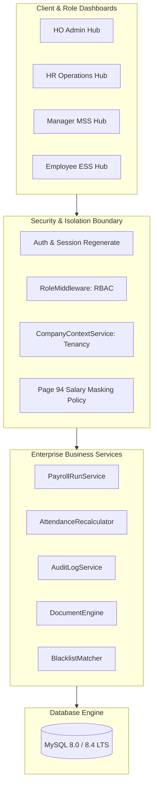

# Enterprise HRMS SaaS Platform

[](https://php.net)
[](https://laravel.com)
[](https://mysql.com)
[](https://getbootstrap.com)
[-12B76A?style=flat-square)](#10-testing--automated-verification)

A modern, high-availability, multi-company Human Resource Management System (HRMS) & Workforce Intelligence platform engineered for manufacturing, industrial, and distributed enterprise operations. Built on **Laravel 13**, **MySQL 8 (8.0.46 / 8.4 LTS)**, **Blade**, **Bootstrap 5.3**, and **Vanilla JavaScript**.

---

## 1. Product Objectives

* **Unified Multi-Company Operations**: Centralize organizational governance across multiple legal entities and manufacturing sites while maintaining strict logical database segregation.
* **Tamper-Evident Auditability**: Maintain immutable governance logs for workforce, onboarding, time, leave, asset, and compensation events.
* **Strict Role-Based Access Control (RBAC)**: Ensure role-separated interfaces across Head Office Administration (`ho_admin`), HR Operations (`hr_executive`), Manager Self-Service (`manager_mss`), and Employee Self-Service (`employee_ess`).
* **Page 94 Compensation Segregation**: Absolute zero-exposure isolation of salary, compensation structures, and payslips from operational managers and unauthorized personnel.
* **Industrial Workforce Resilience**: Handle complex shift rotations, biometric punch logs, overtime workflows, fine recovery installments, and full & final (FNF) settlements.

---

## 2. Core Features & Functional Modules

### 🏢 Master Data & Multi-Tenancy
* **Multi-Company Management**: Manage multiple legal entities (e.g., Vishal Enterprise & Vrishal Eng. Pvt. Ltd.) with company-context switching (`CompanyContextService`).
* **Locations & Plant Sites**: Define physical branches, plants, and ground staff work zones with state-specific professional tax (PT) slabs.
* **Departments & Designations**: Hierarchical organizational units with linked roles and job classifications.
* **Contractor & Manpower Vendors**: Tracking of third-party staffing agencies, PAN/GSTIN compliance, and vendor-linked staff.

### 👥 Workforce Onboarding & Employee 360
* **Multi-Step Onboarding**: Candidate registration, document uploads, and company allocation.
* **eKYC & Identity Verification**: Automated verification attempts, grace periods, and exception approvals.
* **Gate Pass & Access Credentials**: Physical security pass numbers, biometric punch IDs, and corporate identification.
* **Digital Document Locker**: Secure preview, download, and verification workflows for identity proofs and statutory letters.

### 🛡️ Central Cross-Company Blacklist & Whitelist
* **Fraud & Misconduct Registry**: Cross-company deterrence against absconding, theft, and disciplinary terminations.
* **Identity Match Queue**: Fuzzy and exact Aadhaar/PAN matching during candidate pre-screening with resolution workflows.
* **Strict Authorization**: Mandatory executive justification for whitelisting or record deactivation.

### ⏱️ Time, Shifts & Attendance Management
* **Shift Master & Recurring Rosters**: Rotational, rotational-night, and general shift assignments.
* **Biometric Punch Ingestion**: Device staging tables, punch reprocessing, and raw-to-processed reconciliation.
* **Daily Attendance Muster**: Statuses (Present, Absent, Half-Day, On-Leave, Holiday, Weekly-Off), penalty recalculation engines, and regularization requests.
* **Overtime Workflow**: Strict multi-level OT pre-approval and calculation according to statutory formulas.

### 🌴 Leave Management & Compliance
* **Leave Policies & Accruals**: Paid Leave (PL), Casual Leave (CL), Sick Leave (SL), and Compensatory Off (Comp-Off).
* **Sandwich Rule Enforcement**: Automated detection and penalty deduction when leaves sandwich weekly offs or holidays.
* **Financial Year Period Locks**: Immutable locking of previous months/years to prevent retroactive tampering.

### 💰 Payroll, Loans & Statutory Control Tower
* **Salary Structure Engine**: Base pay, HRA, DA, Special Allowances, PF (Employee + Employer), ESI, and Professional Tax.
* **Salary Advances & Loan Recoveries**: Installment scheduling, ledger balancing, and automated payroll deductions.
* **Payroll Execution Control Tower**: Draft runs, pre-payroll validation checks, lock runs, and payslip distribution.
* **Full & Final Settlement (FNF)**: Multi-tier approval workflows, gratuity/leave encashment, asset recovery deductions, and settlement statements.

### 📦 Asset Lifecycle & Damage Recovery
* **Asset Master & Inventory**: Allocation to staff, custody tracking, and return condition inspections.
* **Damage Assessments & Fine Recovery**: Damage logging, policy-driven fine assignments, installment recoveries, and waiver approvals.

### 📄 Letter & Form Print Engine
* **Template Master**: Standardized placeholders for Appointment Letters, Offer Letters, Confirmation Letters, and Experience Certificates.
* **Dompdf Generation**: Pixel-accurate PDF rendering with digital verification barcodes/hashes.
* **Verification Portal**: Public rate-limited authenticity portal (`/verify-document/{code}`).

### 📊 Enterprise Reporting & Intelligence
* **Reports Hub**: 50+ pre-built compliance, workforce, attendance, and payroll reports with CSV (UTF-8 BOM) and PDF export.
* **Bank Advice Engine**: Bank transfer advice generator formatted for corporate banking settlement.
* **Automated Report Schedules**: Background scheduled report generation and delivery logs.

---

## 3. Technology Stack

| Layer | Technology |
|---|---|
| **Backend Framework** | Laravel 13 (`13.39.0`) |
| **Runtime** | PHP 8.3+ (CLI, FPM) |
| **Database** | MySQL 8.0.46 / MySQL 8.4 LTS (Strict UTF8MB4) |
| **Frontend Templates** | Laravel Blade with Enterprise Design System |
| **CSS & Components** | Bootstrap 5.3.3, Bootstrap Icons 1.11.3 |
| **Typography** | Inter (UI), JetBrains Mono (Codes / Hashes) |
| **PDF Generation** | Dompdf (`v3.1.6`) |
| **Charts & Analytics** | Chart.js |

---

## 4. Architecture & Security Overview



### Key Security Implementations:
1. **Multi-Company Context (`CompanyContextService`)**: Tenancy boundaries are enforced on every request. Data queries automatically scope to the active legal entity.
2. **Page 94 Compensation Segregation**: Salary calculations, bank account numbers, and payslips are strictly inaccessible to managers (`manager_mss`) and unauthorized roles.
3. **Audit Trail Logging (`AuditLogService`)**: Tamper-evident logging of authentication, CRUD operations, salary modifications, and blacklist actions.
4. **Decoupled Form Decoys**: Login and onboarding forms include anti-autofill decoy inputs to prevent browser credential managers from injecting administrator credentials into candidate forms.

---

## 5. Prerequisites

Before installing the application, ensure the following software is installed on your host system:

* **PHP 8.3 or higher** with required extensions:
  ```text
  pdo_mysql, mbstring, openssl, bcmath, curl, fileinfo, gd, zip, tokenizer, xml
  ```
* **MySQL 8.0.46 or MySQL 8.4 LTS**
* **Composer 2.7+**
* **Git 2.40+**

> **Note on Database**: This project strictly requires MySQL 8. SQLite is unsupported.

---

## 6. Step-by-Step Local Setup

### 6.1 Clone the Repository
```bash
git clone https://github.com/ashutosh7034/enterprise-hrms-saas.git
cd enterprise-hrms-saas
```

### 6.2 Install PHP Dependencies
```bash
composer install --no-interaction --prefer-dist --optimize-autoloader
```

### 6.3 Configure Environment Variables
Copy `.env.example` to `.env`:
```bash
cp .env.example .env
```

Open `.env` and configure your database parameters:
```ini
APP_NAME="Enterprise HRMS"
APP_ENV=local
APP_KEY=
APP_DEBUG=true
APP_URL=http://localhost:8000

DB_CONNECTION=mysql
DB_HOST=127.0.0.1
DB_PORT=3306
DB_DATABASE=enterprise_hrms
DB_USERNAME=your_db_username
DB_PASSWORD=your_db_password

SESSION_DRIVER=database
QUEUE_CONNECTION=database
CACHE_STORE=database
```

### 6.4 Generate Application Key
```bash
php artisan key:generate
```

### 6.5 Prepare MySQL Database
Open your MySQL terminal or GUI and create the databases:
```sql
-- Development Database
CREATE DATABASE enterprise_hrms CHARACTER SET utf8mb4 COLLATE utf8mb4_unicode_ci;

-- Testing Database (for automated test suite)
CREATE DATABASE enterprise_hrms_test CHARACTER SET utf8mb4 COLLATE utf8mb4_unicode_ci;
```

### 6.6 Run Migrations & Seeders
Execute the database schema migrations and seed foundational data:
```bash
php artisan migrate
php artisan db:seed
```

### 6.7 Start the Application
Run the local development server:
```bash
php artisan serve
```
Access the application at: **`http://127.0.0.1:8000`**

---

## 7. Role-Based Demo Accounts (Local Dev Only)

In local development and testing environments, the following demo personas are seeded:

| Role Code | Role Name | Purpose | Example Identifier |
|---|---|---|---|
| `ho_admin` | Head Office Admin | Multi-company governance, system configuration, audit logs | `ho_admin@enterprise.com` |
| `hr_executive` | HR Operations | Workforce onboarding, attendance, leaves, payroll | `hr@vishal.com` |
| `manager_mss` | Manager Self-Service | Team presence, leave approvals (strictly zero salary view) | `manager@vishal.com` |
| `employee_ess` | Employee Self-Service | Personal attendance, leaves, payslips, document locker | `employee@vishal.com` |

> *Default local password for all seeded accounts is: `password` (change immediately in non-local environments).*

---

## 8. Directory Structure

```text
├── app/
│   ├── Http/
│   │   ├── Controllers/     # Role-scoped & module controllers
│   │   ├── Middleware/      # RBAC, CompanyContext, and auth checks
│   │   └── Requests/        # Form validation request classes
│   ├── Models/              # Eloquent models with global tenancy scopes
│   └── Services/            # Core business, payroll, & audit services
├── config/                  # Application configuration files
├── database/
│   ├── migrations/          # Comprehensive MySQL schema migrations
│   └── seeders/             # Initial company, role, & master seeders
├── docs/                    # Architectural specifications & reports
├── public/
│   ├── css/
│   │   └── enterprise-design-system.css # Unified SaaS design system
│   └── js/                  # Client-side scripts
├── resources/
│   └── views/
│       ├── auth/            # Split-screen SaaS authentication
│       ├── components/ui/   # Reusable dropdowns, modals, & tables
│       ├── dashboards/      # Role-isolated dashboard hubs
│       ├── employees/       # Workforce 360 & onboarding views
│       ├── layouts/         # App shell, sidebar, & topbar
│       ├── masters/         # Standardized master entity management
│       └── payroll/         # Runs, structures, payslips, & FNF
├── routes/
│   └── web.php              # Secure route definitions & RBAC guards
├── storage/                 # Logs, templates, and document generation
└── tests/
    └── Feature/             # Full regression, UAT, and security tests
```

---

## 9. Testing & Automated Verification

The test suite enforces full regression testing on a dedicated MySQL database (`enterprise_hrms_test`).

Run the automated test runner:
```bash
php artisan test
```

### Core Test Suites:
* **`UiScreensVerificationTest`**: Verifies all master screens, design system tokens, and login/logout flows.
* **`RoleBasedDashboardTest`**: Validates role isolation, Page 94 segregation, and candidate email decoupling.
* **`SecurityAuditRegressionTest`**: Enforces legal entity boundaries, raw DB immutability, and credentials protection.
* **`CentralBlacklistTest`**: Verifies trust registry matching, approvals, and whitelist governance.
* **`AssetManagementTest`**: Validates asset allocation, depreciation service, and damage installment recovery.

---

## 10. Deployment Considerations

* **Database Engine**: Strictly provision MySQL 8.0.46+ or 8.4 LTS. Ensure `sql_mode` includes `STRICT_TRANS_TABLES`.
* **HTTPS & SSL**: Terminate TLS using Nginx or Cloudflare. Set `APP_ENV=production` and `APP_DEBUG=false`.
* **Queues & Scheduling**: Configure cron for Laravel Scheduler (`php artisan schedule:run`) and a process manager (e.g., Supervisor) for `queue:work`.
* **File Storage**: Ensure `storage/` and `bootstrap/cache/` directories are writable by the web server process.

---

## 11. Future SaaS Multi-Tenant Architecture

The platform is designed to transition smoothly to a multi-tenant SaaS licensing model:
1. **Tenant Separation**: Existing `CompanyContextService` easily maps to subdomain routing (`tenant.hrms-platform.com`).
2. **Subscription Tiers**: Module gates can be applied to advanced features (e.g., Biometrics, FNF, Automated Bank Advice).
3. **Database Sharding**: Logical company isolation can be upgraded to separate tenant database connections via dynamic connection switching.

---

## 12. License

Proprietary enterprise software developed for Vishal Enterprise & Vrishal Eng. Pvt. Ltd. All rights reserved.
