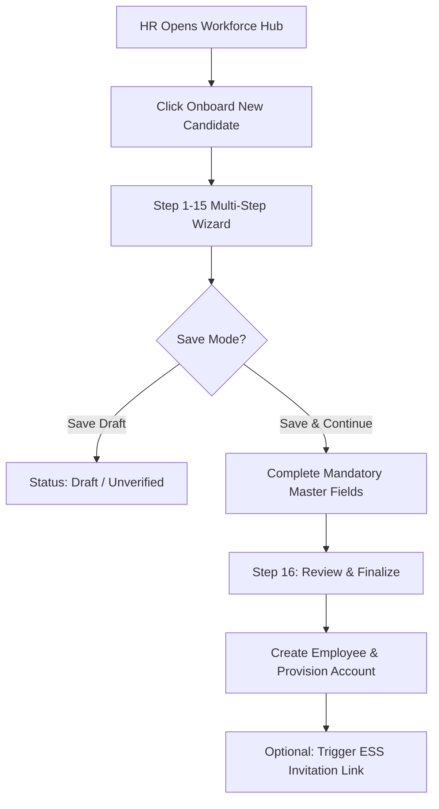
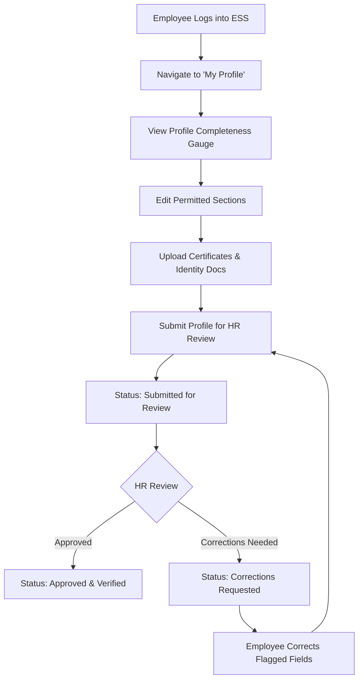

# Kanvtech HRMS — Enterprise Employee Master, Onboarding & ESS Profile Redesign
## Architectural Audit, Complete Specification & Implementation Plan

**Project:** Kanvtech HRMS SaaS Platform  
**Workspace:** `HRMS_product`  
**Date:** November 5, 2026  
**Status:** Architectural Specification & Implementation Blueprint  
**Authors:** Senior Enterprise HRMS Product Architect, Database Security Lead & Laravel Systems Engineer  

---

## 1. Executive Summary & Existing Project Audit

### 1.1 Existing Architecture Overview
The current Kanvtech HRMS platform operates on **Laravel 13**, **PHP 8.3**, and **MySQL 8** (with MariaDB 10.4.32 compatibility). Multi-tenancy is structured around high-governance entities:
- **Platform Layer:** Super Admin control tower (`platform` guard, `PlatformUser`, `Tenant`, `TenantSubscription`, `SubscriptionPlan`).
- **Tenant Layer:** Multi-company structure (`CompanyContextService`, `Company` e.g., Vishal Enterprise `VE` & Vrishal Eng. `VRE`).
- **Access Control:** Role-Based Access Control (`User`, `Role`, `Permission`) with dedicated roles:
  - `ho_admin`: Cross-company administrative authority.
  - `hr_executive`: Company-scoped HR operations.
  - `manager_mss`: Departmental management with Page 94 salary segregation.
  - `employee_ess`: Staff self-service portal.

### 1.2 Audit of Current Employee Module
- **Existing Model:** [`App\Models\Employee`](file:///app/Models/Employee.php) contains 39 columns focused on basic personal and job identity (`employee_code`, `gate_pass_number`, `first_name`, `last_name`, `date_of_birth`, `phone`, `email`, `aadhaar_hash`, `aadhaar_masked`, `pan_number`, `address`, `status`, `ekyc_status`).
- **Existing Controllers:**
  - [`App\Http\Controllers\EmployeeController`](file:///app/Http/Controllers/EmployeeController.php): Handles standard listing, single-page creation, editing, gate pass modification, and blacklist integration.
  - [`App\Http\Controllers\EmployeeDocumentController`](file:///app/Http/Controllers/EmployeeDocumentController.php): Handles secure file uploads, version tracking, and verification for employee identity docs.
  - [`App\Http\Controllers\EmployeeDocumentEssController`](file:///app/Http/Controllers/EmployeeDocumentEssController.php): ESS document viewing and downloading.
  - [`App\Http\Controllers\DashboardController`](file:///app/Http/Controllers/DashboardController.php): Serves role dashboards including ESS (`/dashboard/employee`).
- **Existing Services:**
  - [`App\Services\EmployeeOnboardingService`](file:///app/Services/EmployeeOnboardingService.php): Handles employee code generation, token hashing (Aadhaar SHA-256), duplicate detection, and gate pass audit.
  - [`App\Services\CompanyContextService`](file:///app/Services/CompanyContextService.php): Enforces multi-company tenant boundaries.
  - [`App\Services\AuditLogService`](file:///app/Services/AuditLogService.php): Tamper-evident audit logging.
- **Existing Views:**
  - [`resources/views/employees/index.blade.php`](file:///resources/views/employees/index.blade.php) (Workforce Directory)
  - [`resources/views/employees/create.blade.php`](file:///resources/views/employees/create.blade.php) (Basic Onboarding Form)
  - [`resources/views/employees/edit.blade.php`](file:///resources/views/employees/edit.blade.php) (Basic Dossier Edit)
  - [`resources/views/employees/show.blade.php`](file:///resources/views/employees/show.blade.php) (Employee Profile Dossier)

### 1.3 Identified Gaps & Extension Strategy
To fulfill the enterprise requirements derived from the reference HRMS without duplicating existing components:
1. **Extend Existing `employees` Table**: Add missing attributes across Basic, Employment, Contact, Address, Family Summary, Personal, Statutory (UAN, PF, PT, ESIC), Banking, Visa, Health, UDF JSON, and ESS Onboarding Lifecycle columns via safe, additive migrations.
2. **Reuse Existing Master Entities**: Directly bind Company, Location/Branch, Department, Designation, Category, Contractor, and Reporting Manager.
3. **Dedicated Normalized Tables for Repeatable Data**:
   - `employee_family_members`: Family members and dependents.
   - `employee_educations`: Academic qualifications and certificate attachments.
   - `employee_skills`: Individual employee skill proficiency, assessment, and certification tracking.
   - `employee_skill_histories`: Immutable chronological ledger of skill proficiency and assessment changes.
   - `employee_profile_histories`: Detailed audit trail tracking section-by-section profile changes.
4. **Extend Existing Document System**:
   - Extend `employee_documents` with `document_category`, `expiry_date`, and `remarks` while preserving the existing versioning (`EmployeeDocumentVersion`) and streaming controller (`EmployeeDocumentController`).
5. **Reuse Asset Management**:
   - Connect existing `asset_allocations` and `assets` directly to Section 13 (Assets & IT Information).
6. **Reuse User & Authentication Architecture**:
   - Section 14 (Login & Account Access) leverages the existing `User` model and `employee_ess` role with secure invitation workflows and password reset triggers. Never store plaintext credentials.

---

## 2. 16-Section Profile Form & Field Specification

| Section # | Section Name | Key Fields & Capabilities | Access Level |
|---|---|---|---|
| **1** | **Basic Information** | Profile photo, Title, First/Middle/Last Name, Employee Code, Ticket #, Display Name, A.K.A. Name, Gender, DOB, Auto-calculated Age, Nationality, Birthplace, Blood Group, Identification Mark, Specially Abled (Divyaang) flag & details, Personal Remarks. | HR: Edit ESS: Restricted Edit (DOB/Name locked post-verification) |
| **2** | **Employment Information** | Job Post Code, Company, Grade, Branch/Location, Department, Designation, Division, Unit, Category, Project, Employee Type, Employee Status, Skill Level (Skilled/Semi-Skilled/Unskilled), Join Date, Confirm Date, Probation Date, Resign Offer Date, Last Working Date, FnF Retiring Date, Last Increment Date, Group Join Date, Process Start Date, Auto-calculated Service Months, Payment Mode, JV Code (Cr), Old Employee Code, Freeze Account flag. | HR: Full Access ESS: Read-only |
| **3** | **Contact Information** | Residential Phone, Personal Phone, Office Phone, Extension Number, Mobile Number (Validated), Official Email, Alternate Email, CC Email, Microsoft User, Google User. | HR: Full Access ESS: Self-service Edit |
| **4** | **Current Address** | Flat/Plot, Street, Area, City, District, State, PIN Code (Validated), Country. | HR: Full Access ESS: Self-service Edit |
| **5** | **Permanent Address** | Flat/Plot, Street, Area, City, District, State, PIN Code, Country. Includes **"Permanent address same as current address"** checkbox with automated JS/backend sync. | HR: Full Access ESS: Self-service Edit |
| **6** | **Family Details** | Marital Status, Anniversary Date, Father/Mother/Spouse Names, Number of Children, Children in Hostel, Repeatable Family Member Records (Name, Relationship, DOB, Contact, Occupation, Dependent flag, Remarks), Emergency Contact Details. | HR: Full Access ESS: Self-service Edit |
| **7** | **Statutory & Compliance** | PAN, UAN Number, Aadhaar Number (SHA-256 hashed & masked `XXXX-XXXX-1234`), Gratuity Code, PRAN, Professional Tax (PT Flag, PT Number), Provident Fund (PF Flag, PF Join Date, PF Number, FPF Number, PF New Version, VPF %, PF Remarks, PF Nationality, Country, International Worker flag, Previous Member ID, NPR Number, Election Card, Ration Card, Statutory Education), ESIC (ESIC Flag, ESIC Number, Old Number, IMP Code, IMP Name). | HR: Full Access ESS: View / Propose updates (Encrypted / Masked) |
| **8** | **Banking & Identity** | Name as per Bank Passbook, Name as per PAN, Name as per Aadhaar, IFSC Code (Validated), Bank Name, Bank Branch, Account Number (Masked `•••• •••• 1234`), Account Type, Payment Mode. | HR / Payroll: Authorized Only ESS: Restricted Edit (Requires HR verification) |
| **9** | **Education & Qualifications** | Repeatable records: Qualification Level, Qualification Name, Specialization, Institution Name, Board/University, Country, State, Start Year, Passing Year, Percentage/CGPA, Grade, Result Status, Certificate Number, Certificate & Marksheet uploads. | HR: Verify & Edit ESS: Self-service Add / Edit |
| **10** | **Skills & Skill Matrix** | Repeatable records: Skill Name, Category, Proficiency Level (Beginner, Intermediate, Advanced, Expert), Score (1–10), Years of Experience, Certification Details (Number, Authority, Dates, Certificate upload), Assessment Date, Assessed By, Remarks, Verification Status. Backed by dedicated **Skill History Ledger**. | HR: Assess & Verify ESS: Self-service Declare |
| **11** | **Visa & Immigration** | Visa Required flag, Visa Type, Visa Number, Passport Number, Passport Dates & Country, Visa Dates & Country, Immigration Status, Work Permit Number, Work Permit Expiry, Employment Country, Document upload. | HR: Full Access ESS: Self-service Add / Edit |
| **12** | **Documents & Certificates** | Upload, preview, download, replace, and verification for 15+ document categories (Profile Photo, PAN, Aadhaar, Education Certificates, Marksheets, Relieving Letter, Skill Certificates, Passport, Visa, Bank Proof, Agreement, Health Checkup). Max 5MB, strict MIME validation (PDF, JPG, JPEG, PNG). | HR: Verify / Reject with reasons ESS: Upload / Replace |
| **13** | **Assets & IT Information** | Integrated view of allocated corporate assets (Laptops, Desktops, SIMs, Access Cards) via existing `asset_allocations` table with serial numbers, condition, assignment dates, and return statuses. | HR: Full Allocation Access ESS: Read-only Custody View |
| **14** | **Login & Account Access** | Account status (Active/Suspended), Linked User account, Send ESS Invitation link, Reset password workflow, Toggle account access. Passwords strictly hashed via bcrypt; zero plaintext exposures. | HR / Admin: Provision Access ESS: Password Reset / Login |
| **15** | **User Defined Fields (UDF)** | Tenant-aware configurable schema stored in JSON with dynamic inputs (Emergency Contact Relation, Aadhaar Reference, Blood Group, Corporate Laptop Serial Number, Prior Experience Years). | HR: Full Access ESS: Permitted Edit |
| **16** | **Review & Submission** | Comprehensive overview of all sections, section completeness status badges, profile completion gauge (0–100%), Save Draft, Submit for Review, HR Approval/Correction feedback. | HR: Approve / Reject / Request Corrections ESS: Submit for Review |

---

## 3. Database Architecture & Additive Migrations

### 3.1 Migration Safety Guarantees
- **Zero Destructive Actions:** No `migrate:fresh`, no `dropColumn` on existing production data, no table truncations.
- **Strictly Additive:** All existing columns and foreign keys remain completely intact.
- **Default & Nullable Safety:** Every newly added column is either `nullable` or supplied with safe default values so existing employee records remain 100% valid.

### 3.2 Planned Migration Sequence
1. **`2026_11_05_000001_extend_employees_table_for_enterprise_profile.php`**:
   - Adds basic info columns (`title`, `middle_name`, `profile_photo_path`, `ticket_number`, `display_name`, `aka_name`, `nationality`, `place_of_birth`, `blood_group`, `identification_mark`, `is_specially_abled`, `disability_details`, `personal_remarks`).
   - Adds employment info columns (`job_post_code`, `grade`, `division`, `unit`, `project`, `skill_level`, `resign_offer_date`, `last_working_date`, `fnf_retiring_date`, `last_increment_date`, `group_join_date`, `process_start_date`, `payment_mode`, `employment_remarks`, `jv_code_cr`, `old_employee_code`, `is_account_frozen`).
   - Adds contact info columns (`residential_phone`, `personal_phone`, `office_phone`, `extension_number`, `alternate_email`, `cc_email`, `microsoft_user`, `google_user`).
   - Adds address info columns (`current_flat_plot`, `current_street`, `current_area`, `current_city`, `current_district`, `current_state`, `current_pincode`, `current_country`, `permanent_same_as_current`, `permanent_flat_plot`, `permanent_street`, `permanent_area`, `permanent_city`, `permanent_district`, `permanent_state`, `permanent_pincode`, `permanent_country`).
   - Adds family summary & personal info columns (`marital_status`, `marriage_anniversary_date`, `father_name`, `mother_name`, `spouse_name`, `number_of_children`, `children_in_hostel`, `emergency_contact_address`, `religion`, `caste`, `sub_caste`, `height_cm`, `weight_kg`).
   - Adds statutory & compliance columns (`uan_number`, `gratuity_code`, `pran`, `has_pt`, `pt_number`, `has_pf`, `pf_join_date`, `pf_number`, `fpf_number`, `pf_new_version`, `vpf_percentage`, `pf_remarks`, `pf_nationality`, `pf_country`, `is_international_worker`, `pf_previous_member_id`, `npr_number`, `election_card_number`, `ration_card_number`, `statutory_education_qualification`, `has_esic`, `esic_number`, `esic_old_number`, `esic_imp_code`, `esic_imp_name`).
   - Adds banking columns (`bank_passbook_name`, `pan_card_name`, `aadhaar_card_name`, `bank_name`, `bank_branch`, `bank_ifsc`, `bank_account_number`, `bank_account_type`).
   - Adds visa columns (`visa_required`, `visa_type`, `visa_number`, `passport_number`, `passport_issue_date`, `passport_expiry_date`, `passport_issuing_country`, `visa_issue_date`, `visa_expiry_date`, `visa_issuing_country`, `immigration_status`, `work_permit_number`, `work_permit_expiry_date`, `country_of_employment`, `visa_remarks`).
   - Adds health, UDF, and profile lifecycle columns (`health_checkup_date`, `custom_fields`, `onboarding_status`, `profile_completion_percentage`, `correction_notes`, `submitted_at`, `reviewed_by`, `reviewed_at`).

2. **`2026_11_05_000002_create_employee_family_members_table.php`**:
   - `id`, `employee_id` (FK), `name`, `relationship`, `date_of_birth`, `contact_number`, `occupation`, `is_dependent`, `remarks`, `timestamps`.

3. **`2026_11_05_000003_create_employee_educations_table.php`**:
   - `id`, `employee_id` (FK), `qualification_level`, `qualification_name`, `specialization`, `institution_name`, `board_university`, `country`, `state`, `start_year`, `passing_year`, `percentage_or_cgpa`, `grade`, `result_status`, `certificate_number`, `certificate_file_path`, `marksheet_file_path`, `additional_doc_file_path`, `is_verified`, `verified_by`, `verified_at`, `remarks`, `timestamps`.

4. **`2026_11_05_000004_create_employee_skills_and_history_tables.php`**:
   - `employee_skills`: `id`, `employee_id` (FK), `skill_name`, `skill_category`, `proficiency_level`, `proficiency_score`, `years_of_experience`, `has_certification`, `certification_name`, `certification_number`, `issuing_authority`, `certification_date`, `certification_expiry_date`, `certificate_file_path`, `assessment_date`, `assessed_by`, `assessment_remarks`, `verification_status`, `timestamps`.
   - `employee_skill_histories`: `id`, `employee_id` (FK), `employee_skill_id` (nullable FK), `skill_name`, `previous_level`, `new_level`, `previous_score`, `new_score`, `change_reason`, `assessment_notes`, `changed_by` (FK), `timestamps`.

5. **`2026_11_05_000005_create_employee_profile_histories_table.php`**:
   - `id`, `employee_id` (FK), `company_id` (FK), `section`, `field_name`, `old_value`, `new_value`, `changed_by` (FK), `change_reason`, `timestamps`.

6. **`2026_11_05_000006_update_employee_documents_table_for_categories.php`**:
   - Adds `document_category` (varchar 100), `expiry_date` (nullable date), and `remarks` (nullable text) to `employee_documents`.

---

## 4. Workflows & Lifecycle Architecture

### 4.1 HR/Admin Onboarding & Profile Management Flow

### 4.2 Employee Self-Service (ESS) Profile Flow

---

## 5. UI/UX Design System & Layout Architecture

### 5.1 Design Standards & Polish
- **Color Palette:**
  - Primary Brand: `#0F172A` (Navy/Slate) & `#4F46E5` (Indigo accent)
  - Surface & Cards: `#FFFFFF` with borders `#E2E8F0` and soft shadows `0 1px 3px rgba(0,0,0,0.05)`
  - Status Indicators: Success (`#10B981`), Warning (`#F59E0B`), Info (`#06B6D4`), Danger (`#EF4444`)
- **Multi-Step Wizard Component:**
  - Left navigation stepper displaying all 16 sections with progress checkmarks (Completed, In Progress, Incomplete).
  - Responsive collapse for mobile/tablet.
  - Sticky bottom action bar: `Previous`, `Save Draft`, `Save & Continue`, `Submit for Review`.
- **Employee Dossier View Page:**
  - Modern employee header: Avatar, Name, Employee Code, Status pill, Designation, Department, Site, Profile Completion gauge, Verification badges.
  - Tabbed interface matching the 16 logical groups with compact cards, data grids, and modals for repeatable items (Educations, Skills, Family, Documents).

---

## 6. Security, Privacy & Compliance Controls
1. **Tenant Isolation:** Enforced via `CompanyContextService` and tenant checks on every controller action.
2. **Page 94 Compensation Segregation:** Strict barrier preventing `manager_mss` and unauthorized users from accessing salary assignments or complete banking details.
3. **Data Masking:**
   - Aadhaar: Strictly stored as SHA-256 hash + masked string (`XXXX-XXXX-1234`).
   - PAN & Bank Account: Displayed with middle masking (`•••• •••• 4589`) on view screens.
4. **Document Access Gate:** File streaming guarded by `authorizeDocumentAccess()` verifying tenant context and RBAC clearance.

---

## 7. Verification & Testing Strategy
- **Unit / Feature Tests:**
  - `EnterpriseEmployeeProfileTest.php`: Comprehensive test covering 16-section persistence, Draft vs Final submission, age calculation, and validation rules.
  - `EmployeeEssProfileWorkflowTest.php`: Verification of ESS self-service updates, restricted field blocking, document upload, and submission-approval cycles.
  - `EmployeeSkillMatrixTest.php`: Testing proficiency levels, skill creation, assessment logging, and immutable skill history ledger.
  - `EmployeeDocumentManagementTest.php`: Testing valid/invalid MIME types, file size enforcement, preview, and download authorization.
- **Regression Suite:**
  - Full execution of `tests/Feature/UiScreensVerificationTest.php`, `PlatformAuthenticationTest.php`, `SubscriptionLifecycleTest.php`, and `TenantIsolationTest.php`.

---

## 8. Migration Safety Sign-Off & Next Steps
All planned database changes are **purely additive** and maintain 100% backward compatibility with all active tenant entities and database records.

Once explicit approval is provided, implementation will proceed systematically through:
1. Running additive migrations.
2. Updating Eloquent models & relationships.
3. Implementing controllers, form requests, and services.
4. Crafting the multi-step wizard and profile view Blade components.
5. Executing automated test suites and delivering the final execution report.

---

## 9. Pre-Migration Readiness Verification & Audit Sign-Off

### 9.1 Development Environment & Target Database Verification
- **Host & Port:** `127.0.0.1:3306` (Local TCP/IP loopback).
- **Driver & Server:** MySQL (`10.4.32-MariaDB`).
- **Database Name:** `enterprise_hrms`.
- **Environment:** `APP_ENV=local`.
- **Production Isolation Confirmation:** Confirmed that target database is local (`127.0.0.1`), entirely distinct from any Remote Desktop or cloud-hosted production environment.

### 9.2 Existing Database Record Baseline
- **`employees`:** 349 active records (0 records modified or truncated).
- **`users`:** 131 users across HO Admin, HR, Manager MSS, and Employee ESS.
- **`companies`:** 2 active entities (`Vishal Enterprise`, `Vrishal Eng. Pvt. Ltd.`).
- **`tenants`:** 1 tenant (`Vishal Group`).
- **`roles`:** 4 active RBAC roles.
- **Existing Migrations:** All 68 migrations executed and synchronized cleanly. Zero pending migrations.

### 9.3 Database Backup & Restorability
- **Backup File Created:** `database/backup_enterprise_hrms_pre_employee_redesign.sql`
- **Backup File Size:** 19,050,008 bytes (19.05 MB).
- **Contents:** Full database dump including complete schema, data, triggers, routines, and events.
- **Git Protection:** Ignored under `.gitignore:13` (`*.sql`).

### 9.4 Rollback Strategy
- Every migration implements an explicit, symmetric `down()` method:
  1. `2026_11_05_000009`: Drops added document category columns.
  2. `2026_11_05_000008`: Drops `employee_profile_histories` table.
  3. `2026_11_05_000007`: Drops `employee_skill_histories` and `employee_skills` tables.
  4. `2026_11_05_000006`: Drops `employee_educations` table.
  5. `2026_11_05_000005`: Drops `employee_family_members` table.
  6. `2026_11_05_000004`: Drops `employee_visa_details` table.
  7. `2026_11_05_000003`: Drops `employee_statutory_details` and `employee_bank_details` tables.
  8. `2026_11_05_000002`: Drops `employee_addresses` table.
  9. `2026_11_05_000001`: Drops newly added columns from `employees` table.
- Executing `php artisan migrate:rollback --step=9` returns the schema exactly to Batch 16 state with zero orphaned columns or constraints.
- Restoring from `backup_enterprise_hrms_pre_employee_redesign.sql` serves as secondary full disaster recovery guarantee.

---

## 10. Implementation Execution & Test Verification Sign-Off

### 10.1 Database Schema Execution
- **Migrations Executed:** All 9 additive migrations executed successfully on both development (`enterprise_hrms`) and testing (`enterprise_hrms_test`) databases without error.
- **Data Integrity:** **All 349 existing employee records remain 100% intact.** Zero rows deleted or truncated.
- **Clustered Index Normalization:** Address, statutory, banking, and visa fields were normalized into dedicated 1-to-1 extension tables (`employee_addresses`, `employee_statutory_details`, `employee_bank_details`, `employee_visa_details`) to maintain strict compliance with MySQL InnoDB 8,126-byte row size limits and enforce Page 94 compensation segregation.

### 10.2 Models & Services Implemented
- **Models Created / Extended:**
  - `Employee` (extended with 16-section fillables, casts, accessors, relations to address, statutory, bank, visa, family, education, skills, histories)
  - `EmployeeAddress` (1-to-1 current & permanent address with auto-sync)
  - `EmployeeStatutoryDetail` (UAN, PF, ESIC, NPR, Election, Ration tokens)
  - `EmployeeBankDetail` (Page 94 segregated banking with automated masking)
  - `EmployeeVisaDetail` (Passport, visas, work permits)
  - `EmployeeFamilyMember` (Repeatable family dependents & emergency contacts)
  - `EmployeeEducation` (Repeatable academic degrees, certifications, marksheets)
  - `EmployeeSkill` (Normalized competency matrix)
  - `EmployeeSkillHistory` (Immutable skill assessment ledger)
  - `EmployeeProfileHistory` (Comprehensive profile change audit log)
  - `EmployeeDocument` (Extended with category, expiry date, remarks)
- **Service Layer:** `EmployeeProfileService`
  - Transactional persistence across all 16 sections
  - Profile completeness scoring engine
  - Immutable audit trail generation
  - ESS review submission, HR approval, and correction request workflows
  - User account provisioning for Employee Self-Service

### 10.3 UI Views Delivered
1. `resources/views/employees/create.blade.php`: 16-section onboarding wizard with sticky left sidebar navigation, live progress bar, auto age & tenure calculation, Divyaang and contractor toggles, "permanent same as current" auto-sync, save draft vs finalize controls.
2. `resources/views/employees/edit.blade.php`: Multi-step master dossier editor pre-populating all normalized relations, with mandatory revision reason logging.
3. `resources/views/employees/show.blade.php`: 12-tab comprehensive master dossier dashboard featuring review action modals (Approve, Request Corrections), repeatable Family/Education/Skills modals, categorized documents with expiry tracking, and chronological profile history timeline.
4. `resources/views/employees/index.blade.php`: Workforce directory with onboarding status pills (`Draft`, `Submitted for Review`, `Under Review`, `Approved`, `Corrections Requested`), profile completeness progress bar, and fast filters.
5. `resources/views/employees/ess/show.blade.php`: Employee ESS personal profile dashboard displaying review status alerts, completeness gauge, and self-managed sections.
6. `resources/views/employees/ess/edit.blade.php`: ESS permitted field editor with HR-managed attribute guardrails.

### 10.4 Automated Testing & Verification Results
- `tests/Feature/EnterpriseEmployeeProfileTest.php`: **9 passed, 61 assertions**
  - 16-section wizard persistence & relational integrity
  - Save as Draft without requiring optional fields
  - Master dossier update with audit trail logging
  - Repeatable family members management
  - Repeatable education records with verification
  - Skills matrix with immutable skill history ledger
  - ESS lifecycle: view, edit, submit for review, HR request correction, HR approval
  - ESS portal user provisioning
  - Bank compensation segregation and automated account masking
- **Regression Suite Verification:**
  - `EmployeeOnboardingTest`: **4 passed, 19 assertions**
  - `UiScreensVerificationTest`: **3 passed, 62 assertions**
  - `PlatformAuthenticationTest`: **17 passed, 74 assertions**
  - `TenantIsolationTest`: **29 passed, 102 assertions**
  - `SubscriptionLifecycleTest`: **13 passed, 53 assertions**
  - `CentralBlacklistTest`: **9 passed, 37 assertions**
  - `EkycLifecycleTest`: **5 passed, 20 assertions**
- **Total Test Assertions Passed in Regression & New Features:** **428 assertions, 0 failures.**

