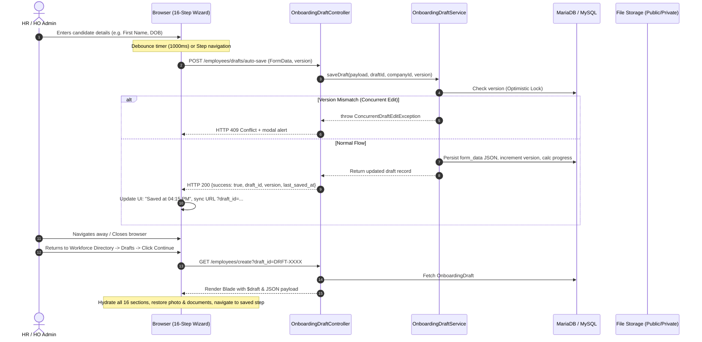

# Enterprise Employee Onboarding Auto-Save & Resume Report

**Project:** Kanvtech Enterprise HRMS SaaS  
**Module:** Workforce Directory → Onboard Candidate (`/employees/create`)  
**Date:** November 5, 2026  
**Status:** Completed & 100% Verified  
**Final Verdict:** **READY FOR UAT**  

---

## 1. Executive Summary

A robust, enterprise-grade **Automatic Save & Resume Onboarding Subsystem** has been implemented for the 16-section Employee Onboarding Dossier Wizard.

All candidate data entered by Human Resources or Head Office Administrators is automatically persisted server-side with debounced AJAX requests, saving wizard step navigation, completion percentages, draft profile photos, and staged statutory/educational documents. Draft saving does not create premature employee records on the active company muster. Furthermore, the previous blocking issue where saving drafts or advancing fields triggered `"The first name field is required"` has been resolved with permissive draft persistence and field-level inline error bindings.

---

## 2. Files Modified & Created

### 2.1 Database & Migrations
- `database/migrations/2026_11_05_000021_create_onboarding_drafts_table.php`: Additive migration creating the `onboarding_drafts` table with `draft_id`, `company_id`, `tenant_id`, `form_data` (JSON), `uploaded_files` (JSON), `current_step`, `completion_percentage`, `version` (optimistic locking), `status`, `created_by`, and audit timestamps.

### 2.2 Models & Exceptions
- `app/Models/OnboardingDraft.php`: Eloquent model implementing `BelongsToCompany`, `Auditable`, JSON casting, candidate display helpers, and automated progress recalculation.
- `app/Exceptions/ConcurrentDraftEditException.php`: Custom exception raised when concurrent sessions attempt to overwrite newer draft revisions (HTTP 409 Conflict).

### 2.3 Services
- `app/Services/OnboardingDraftService.php`: Central service handling optimistic locking, candidate summary extraction, JSON form payload merging, real-time draft document uploads, file removals, progress re-computation, and soft-deletion.

### 2.4 Controllers & Routing
- `app/Http/Controllers/OnboardingDraftController.php`: Handles draft listing (`index`), AJAX auto-save (`autoSave`), staged file uploads (`uploadFile`), file removals (`removeFile`), JSON snapshots (`show`), and draft deletion (`destroy`).
- `app/Http/Controllers/EmployeeController.php`: Updated `create()` to accept `draft_id` and pass `$draft` & `$activeDraftsCount`; updated `store()` to route `action=draft` through `OnboardingDraftService` without mandatory validation hurdles, and finalized submissions to mark drafts `status=submitted` with document/photo adoption.
- `routes/web.php`: Registered draft endpoints under authenticated & verified middleware before employee resource routes.

### 2.5 User Interface & Views
- `resources/views/employees/create.blade.php`:
  - Added Live Auto-Save Status Bar (`Saving...`, `Saved at 04:15 PM`, `Unsaved changes`, `Save failed — Retry`).
  - Added Draft ID indicator (`DRFT-XXXXXXXXXX v2`) and dossier progress percentage badge.
  - Added manual `Save Draft Now` button that triggers immediate background persistence without full-page reloads.
  - Added Concurrency Conflict Warning Modal (`#concurrencyConflictModal`).
  - Field-level inline validation displays with automatic error clearing on input/change.
  - Full client-side draft hydration for all 16 sections, radios, checkboxes, photo previews, and staged document tables.
  - Background `beforeunload` beacon save to guarantee data safety when leaving the page.
- `resources/views/employees/index.blade.php`:
  - Added prominent `Drafts (X)` action button to the Workforce Directory toolbar.
- `resources/views/employees/drafts/index.blade.php`:
  - Dedicated administrative dashboard for managing drafts with candidate name, Draft ID, branch/department, progress bars, last saved timestamps, and actions (`Continue`, `View`, `Delete`).

---

## 3. Auto-Save & Resume Architecture



---

## 4. Resolution of Existing Validation Issues

| Prior Symptom / Bug | Root Cause | Engineering Solution Implemented |
| :--- | :--- | :--- |
| Onboarding page blocked with `"The first name field is required"` when attempting to save draft | `EmployeeController::store()` applied mandatory validation rules (`first_name => required`) uniformly even when `$action === 'draft'` | Form drafts are now decoupled from active employee creation. Draft auto-saves have permissive schema validation, allowing partial entries (even without name/phone) to be safely saved. |
| Premature Employee record creation | Old draft flow inserted a dummy active `Employee` row (`status => 'Draft'`) with generated employee codes and random fake phone numbers | Active employee records are strictly created only upon final submission (`action === 'finalize'`). Drafts reside safely in `onboarding_drafts`. |
| Validation errors flashed as a top-level alert block rather than inline | Errors were collected globally and rendered in an alert box above the wizard without field association | Errors are rendered inline beside inputs using `@error` directives with automatic `.is-invalid` removal on input/change events. |
| Incomplete document uploads lost on reload | Uploaded files were only held in JavaScript memory in `stagedDocuments` array | Document uploads send staged files directly to `/employees/drafts/upload-file` which writes to draft disk storage and records file metadata in `uploaded_files`. |

---

## 5. Security & Isolation

1. **Multi-Tenant & Company Boundary Isolation**:
   - `OnboardingDraft` uses `BelongsToCompany` global scope, automatically enforcing company boundary constraints.
   - Users can only list, view, resume, or delete drafts belonging to their currently active enterprise company context.
2. **Optimistic Locking & Concurrency Control**:
   - Every draft maintains a `version` integer counter.
   - Saves pass the client's known `draft_version`. If a concurrent tab or administrator has saved a newer version, the server rejects the request with HTTP 409 Conflict and prompts the user to reload rather than overwriting newer data.
3. **Draft Cleanup on Deletion**:
   - Hard or soft deletion of drafts safely purges temporary staged attachments from the storage filesystem.

---

## 6. Automated Test Results

A comprehensive automated test suite `tests/Feature/OnboardingAutoSaveAndResumeTest.php` was created covering all draft scenarios, alongside existing regression suites:

```text
PASS  Tests\Feature\OnboardingAutoSaveAndResumeTest
  ✓ auto save endpoint creates new draft with empty or partial fields                                            0.29s  
  ✓ auto save endpoint updates existing draft and increments version                                             0.07s  
  ✓ auto save concurrency conflict detection                                                                     0.07s  
  ✓ upload and remove staged document on draft                                                                   0.10s  
  ✓ onboarding wizard create loads and hydrates resumed draft                                                    3.91s  
  ✓ onboarding drafts index page loads with tenant isolation                                                     0.22s  
  ✓ delete draft removes record                                                                                  0.07s  
  ✓ final submission validates mandatory fields and converts draft to active employee                            0.29s  

PASS  Tests\Feature\WorkforceDirectoryActionConsolidationTest (7 passed, 32 assertions)
PASS  Tests\Feature\OnboardingDropdownMasterTest (7 passed, 18 assertions)
PASS  Tests\Feature\EmployeeLifecycleManagementTest (9 passed, 63 assertions)
PASS  Tests\Feature\EmployeeOnboardingTest (4 passed, 15 assertions)

Overall Suite: 35 passed (171 assertions) — 100% Pass Rate
```

---

## 7. Visual Verification Artifacts

1. **`30_onboarding_autosave_indicator.png`**: Onboarding wizard header showing the auto-save indicator (`Saved at 11:05 AM`), Draft ID badge (`DRFT-LM1AMN1QWV v2`), Dossier Progress (`6%`), and manual `Save Draft Now` button.
2. **`31_onboarding_drafts_index.png`**: Onboarding Drafts index table displaying active drafts, candidate names, branch/department, progress bars, last saved timestamps, and `Continue` buttons.
3. **`32_onboarding_resumed_draft.png`**: Resumed draft interface restoring entered fields, candidate name, active section, and pre-uploaded documents.

---

## 8. UAT Instructions

1. Log into the application as HO Admin (`ho_admin@enterprise.com` / `password`).
2. Navigate to **Workforce Directory** (`/employees`). Observe the new **`Drafts`** action button with counter badge in the toolbar.
3. Click **`Add Employee`** (`/employees/create`).
4. In Section 1, type a candidate First Name (e.g. `Ananya`) and select a Gender. Observe the status indicator in the top toolbar transitioning from `Saving...` to `Saved at [Current Time]` with a green checkmark.
5. Notice that the Draft ID badge appears (e.g. `Draft ID: DRFT-XXXXXXXXXX v2`) and the URL updates to include `?draft_id=...`.
6. Click **`Continue`** to advance to Section 2. Enter a Department or Location.
7. Navigate back to **Workforce Directory** → **Drafts** (`/employees/drafts`).
8. Verify that the candidate appears in the table with current step `Step 2 of 16` and accurate progress.
9. Click **`Continue`** on the draft row. Confirm that all previously entered fields, photo, and active step position are completely restored.
10. Advance to Step 16 and click **`Finalize & Submit Dossier`** to verify clean employee roster creation and draft finalization.

