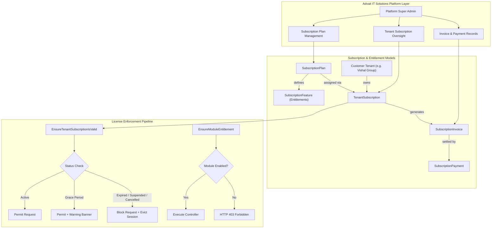
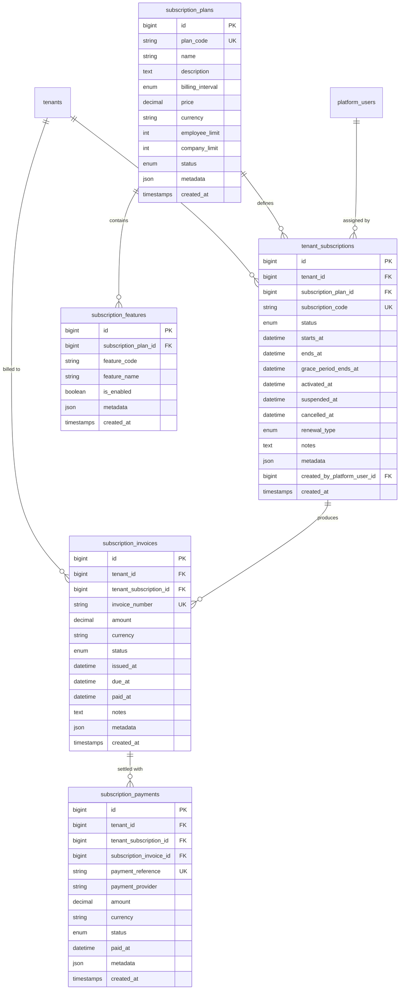
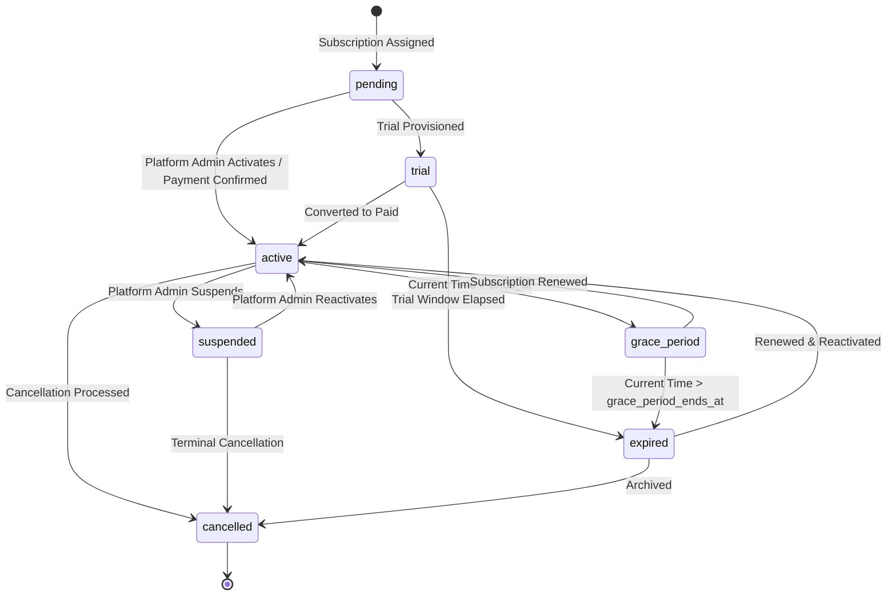
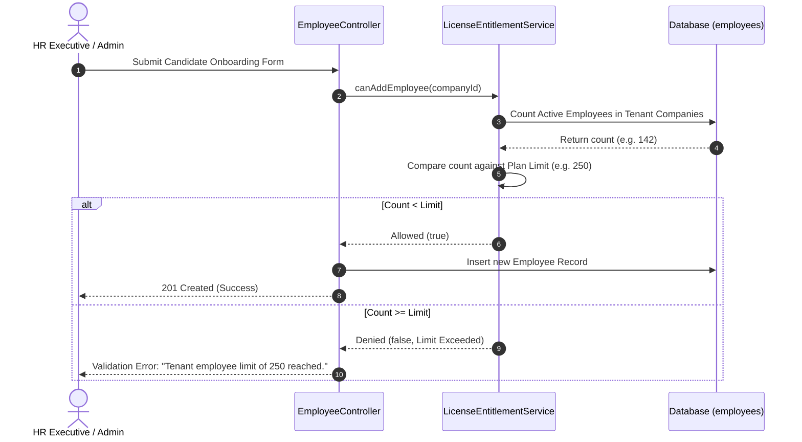
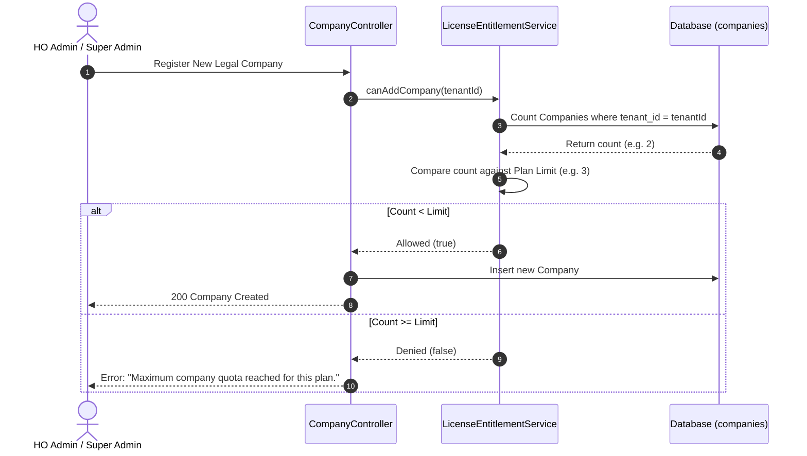

# ENTERPRISE HRMS SaaS — PHASE 3 SUBSCRIPTION ARCHITECTURE SPECIFICATION
## Licensing & Subscriptions Engine Architecture

**Product:** Enterprise HRMS SaaS  
**Platform Owner:** Advait IT Solutions & Services  
**Document:** System Architecture Specification (Phase 3)  
**Date:** November 3, 2026  
**Status:** Approved Architecture  

---

## 1. ARCHITECTURAL OVERVIEW

The Licensing & Subscriptions Engine provides the commercial and entitlement foundation for Advait IT Solutions & Services. It bridges platform administrative controls with tenant operational capabilities, enforcing license validity, user limits, and module permissions without compromising multi-tenant security boundaries.

---

## 2. ENTITY RELATIONSHIP DIAGRAM (ERD)

---

## 3. SUBSCRIPTION LIFECYCLE STATE MACHINE

The tenant subscription lifecycle operates as a finite state machine:

### State Definitions
1. **`pending`**: Subscription registered but awaiting administrative activation or payment confirmation.
2. **`trial`**: Complimentary evaluation window with full or restricted feature access.
3. **`active`**: Commercial active license. All permitted modules and operations functional.
4. **`grace_period`**: Expiry date has passed, but tenant is granted an operational window (typically 7–14 days) before total lockout. Warning banner rendered.
5. **`expired`**: Validity period and grace window elapsed. Customer HRMS operations locked out; session evicted.
6. **`suspended`**: Customer access administratively frozen (e.g. billing breach or legal hold).
7. **`cancelled`**: Contract terminated. Historical records preserved, operational access blocked.

---

## 4. MODULE & FEATURE ENTITLEMENT TAXONOMY

The platform structures features as configurable keys assigned to plans:

| Feature Code | Human Name | Scope of Coverage |
| :--- | :--- | :--- |
| `employee_management` | Workforce & Onboarding | Employee directory, profile, eKYC, gate pass, blacklist checks |
| `attendance_management`| Time & Attendance | Punch logs, biometric integration, regularization, muster |
| `leave_management` | Leave & Sandwich Policies | Leave balances, accruals, carry forwards, comp-offs, workflow |
| `payroll_management` | Payroll & Statutory Engine| Salary structures, runs, statutory PF/ESI/PT/TDS, payslips |
| `asset_management` | Asset Lifecycle | Asset inventory, allocation, return, depreciation, damage recovery |
| `document_management` | Document Generation & ESS | Document templates, versioning, generation, digital download |
| `reports` | Analytics & Scheduled Reports | Standard reports, Excel/PDF exports, automated cron delivery |
| `recruitment` | Talent Acquisition | Candidate pipeline, job requisitions, offer letters |
| `performance_management`| Appraisal & Goals | KPI tracking, annual reviews, 360 feedback |
| `employee_self_service`| ESS Portal | Personal leave/punch logs, payslip viewing, doc download |
| `manager_self_service` | MSS Portal | Team muster, regularization reviews, leave approval |

---

## 5. LICENSE LIMIT VALIDATION FLOW

### 5.1 Maximum Active Employees Check

### 5.2 Maximum Legal Companies Check

---

## 6. BILLING-READY DESIGN & INVOICING ARCHITECTURE

To ensure seamless future integration with payment gateways such as **Razorpay**, **Cashfree**, or **Stripe**, the billing foundation establishes:
1. **Deterministic Invoice Numbering:** Formatted as `INV-YYYY-XXXXX` (e.g. `INV-2026-00001`).
2. **Provider Abstraction:** The `subscription_payments` table stores `payment_provider` (`manual_bank_transfer`, `offline_cheque`, `razorpay`, `stripe`) and `payment_reference`.
3. **Idempotent Webhook Handling:** Invoices cannot be double-paid. Payments are recorded inside database transactions that immediately advance the subscription status.
4. **Zero PCI DSS Exposure:** No credit card numbers, CVV codes, or net banking passwords are ever stored or processed by the application.

---

## 7. AUDIT TRAIL INTEGRATION

All subscription events are tracked in `platform_audit_logs`:
- `SUBSCRIPTION_PLAN_CREATED`
- `SUBSCRIPTION_PLAN_UPDATED`
- `TENANT_SUBSCRIPTION_ASSIGNED`
- `TENANT_SUBSCRIPTION_ACTIVATED`
- `TENANT_SUBSCRIPTION_RENEWED`
- `TENANT_SUBSCRIPTION_SUSPENDED`
- `TENANT_SUBSCRIPTION_REACTIVATED`
- `TENANT_SUBSCRIPTION_CANCELLED`
- `INVOICE_GENERATED`
- `PAYMENT_RECORDED`

This guarantees complete traceability under Advait IT Solutions & Services management.

