# ENTERPRISE HRMS — SAAS MULTI-TENANT ARCHITECTURE AUDIT
**Document Reference**: `docs/SAAS_TRANSFORMATION_AUDIT.md`  
**Platform Owner**: Advait IT Solutions and Services  
**Project**: Enterprise HRMS SaaS Transformation  
**Framework**: Laravel 13, PHP 8.3, MySQL 8 (8.0.46 / 8.4 LTS)  
**Date**: November 2026  
**Status**: Completed (Phase 0 Audit)

---

## 1. Executive Summary

This audit establishes the architectural foundation for evolving the **Enterprise HRMS** application from a single-deployment, multi-company corporate platform into a commercially sellable, multi-tenant Software-as-a-Service (SaaS) application owned and operated by **Advait IT Solutions and Services**.

The platform transformation will introduce:
1. **Platform Super Admin Layer**: A dedicated administrative interface (`/platform/login` → `/platform/dashboard`) enabling Advait IT Solutions to onboard customer organizations, provision licenses, configure subscriptions, toggle module entitlements, and monitor platform health without logging into customer HRMS accounts.
2. **Normalized Multi-Tenant Data Hierarchy**: An organizational tree separating the platform owner from customer tenants, group holding companies, and individual operating companies.
3. **Flexible Licensing Engine**: Enforcing **Single Company Licenses** (strictly 1 operating company) and **Group Company Licenses** (up to $N$ operating companies, with inter-company switching), bounded by employee headcount quotas, module entitlements, and lifecycle validity periods (`Active`, `Suspended`, `Expired`, `Pending Activation`).
4. **Zero-Downtime, Non-Destructive Migration Strategy**: Preserving 100% of existing historical data for **Vishal Enterprise** and **Vrishal Eng. Pvt. Ltd.**, maintaining existing primary/foreign key relationships, and ensuring that all existing HRMS business logic (payroll calculations, statutory rules, biometric ingestion, and audit trails) remains intact.

---

## 2. Existing Architecture & Tenancy Baseline

### 2.1 Technology Stack & Runtime
- **Backend Framework**: Laravel 13 (`13.39.0`) running on PHP 8.3 CLI/FPM.
- **Database Engine**: MySQL 8.0.46 / 8.4 LTS (strict `utf8mb4_unicode_ci`).
- **Frontend Architecture**: Server-rendered Laravel Blade with an Enterprise Design System (`public/css/enterprise-design-system.css`), Bootstrap 5.3.3, and vanilla JavaScript.
- **Reporting & Documents**: Dompdf (`v3.1.6`) for document and payslip generation.

### 2.2 Current Company-Based Isolation Model
Currently, multi-company separation operates at the legal company level via:
1. **`companies` Table**: Holds legal entities (`id: 1` = Vishal Enterprise `VE`, `id: 2` = Vrishal Eng. Pvt. Ltd. `VRE`).
2. **`CompanyContextService`**: Manages the session key `active_company_id`.
   - Resolves active company from session or user assignment.
   - Restricts company switching to users with `can_switch_company = true` or `ho_admin` role.
3. **`BelongsToCompany` Model Trait**: Automatically injects a global query scope:
   ```php
   static::addGlobalScope('company', function (Builder $builder) {
       $companyContext = app(CompanyContextService::class);
       $activeCompanyId = $companyContext->getActiveCompanyId();
       if ($activeCompanyId !== null) {
           $builder->where($builder->getModel()->getTable() . '.company_id', $activeCompanyId);
       }
   });
   ```
4. **Operating Models with `company_id`**: 50+ models directly reference `company_id` (e.g., `Employee`, `AttendanceRecord`, `PayrollRun`, `SalaryStructure`, `Location`, `Department`, `Asset`, `LeaveApplication`, etc.).

---

## 3. Data Isolation Risks & Vulnerabilities in Current Code

The audit revealed the following security and isolation boundaries that must be hardened for SaaS multi-tenancy:

| Area | Current Behavior | Multi-Tenant SaaS Risk | Required Hardening |
|---|---|---|---|
| **Company Switching** | `CompanyContextService::getAccessibleCompanies()` returns `Company::where('status', 'Active')->get()` for any `ho_admin`. | In a SaaS environment, an administrator of Tenant A could switch into a company owned by Tenant B. | Scope company resolution strictly to `$user->tenant_id`: `Company::where('tenant_id', $user->tenant_id)->where('status', 'Active')->get()`. |
| **Active Company Validation** | `setActiveCompanyId($companyId)` only checks if `$companyId` exists in `companies`. | A malicious user could forge a POST request with Tenant B's `company_id`. | Validate that `$companyId` belongs to the authenticated user's `tenant_id`. |
| **Authentication Guards** | Single `web` guard in `config/auth.php` for all users. | Mixing platform super administrators and customer staff in the same table increases enumeration and privilege escalation attack vectors. | Introduce a dedicated `platform` guard and `platform_users` table for Advait IT Solutions personnel. |
| **Module Access** | All routes are statically available based on RBAC roles (`ho_admin`, `hr_executive`, etc.). | Customers could access unpurchased modules (e.g., biometrics or advanced reporting) if not licensed. | Introduce `tenant_module_entitlements` and a route middleware `CheckTenantModuleEntitlement`. |
| **Headcount & Quotas** | Onboarding allows unlimited candidate creation. | Customers could exceed licensed employee or company limits. | Enforce quota checks in `EmployeeController::store` and `CompanyController::store` against `tenant_licenses`. |

---

## 4. Proposed SaaS Multi-Tenant Conceptual Architecture

```mermaid
flowchart TD
    subgraph SaaS_Owner [SaaS Platform Owner: Advait IT Solutions & Services]
        SA[Platform Super Admin]
        PL_AUTH["/platform/login (Guard: platform)"]
        PL_DASH["/platform/dashboard"]
    end

    subgraph Tenant_Layer [Customer Tenants: tenants table]
        T1["Tenant 1: Vishal Group (Group License)"]
        T2["Tenant 2: ABC Industries (Single License)"]
    end

    subgraph License_Sub [Licensing & Entitlements]
        L1["License: Max 5 Companies, 500 Employees"]
        L2["License: Max 1 Company, 50 Employees"]
        M1["Modules: All 9 Modules Enabled"]
        M2["Modules: Core HR + Payroll Only"]
    end

    subgraph Company_Layer [Operating Legal Companies: companies table]
        C1["Company 1: Vishal Enterprise (tenant_id: 1)"]
        C2["Company 2: Vrishal Eng. Pvt. Ltd. (tenant_id: 1)"]
        C3["Company 3: ABC Pvt. Ltd. (tenant_id: 2)"]
    end

    subgraph HRMS_App [Customer HRMS Layer: /login (Guard: web)]
        TA["Tenant Admin / HO Admin"]
        HR["HR Executive"]
        MGR["Manager MSS (Page 94 Isolated)"]
        EMP["Employee ESS"]
    end

    SA --> PL_AUTH --> PL_DASH
    PL_DASH -->|Provisions & Manages| T1
    PL_DASH -->|Provisions & Manages| T2
    T1 --- L1
    T1 --- M1
    T2 --- L2
    T2 --- M2
    T1 --> C1
    T1 --> C2
    T2 --> C3
    C1 & C2 --> HRMS_App
    C3 --> HRMS_App
```

---

## 5. Normalized MySQL Schema Design

### 5.1 New Tables

#### 1. `tenants`
Master record for each customer organization.
```sql
CREATE TABLE `tenants` (
    `id` BIGINT UNSIGNED AUTO_INCREMENT PRIMARY KEY,
    `tenant_code` VARCHAR(50) NOT NULL UNIQUE,
    `name` VARCHAR(255) NOT NULL,
    `organization_type` ENUM('Individual Company', 'Group Company') NOT NULL DEFAULT 'Individual Company',
    `status` ENUM('Active', 'Suspended', 'Pending Activation', 'Terminated') NOT NULL DEFAULT 'Active',
    `contact_email` VARCHAR(255) NOT NULL,
    `contact_person` VARCHAR(255) NOT NULL,
    `contact_phone` VARCHAR(50) NOT NULL,
    `address` TEXT NULL,
    `city` VARCHAR(100) NULL,
    `state` VARCHAR(100) NULL,
    `country` VARCHAR(100) NOT NULL DEFAULT 'India',
    `gst_number` VARCHAR(50) NULL,
    `created_at` TIMESTAMP NULL,
    `updated_at` TIMESTAMP NULL,
    `deleted_at` TIMESTAMP NULL,
    INDEX `idx_tenants_status` (`status`),
    INDEX `idx_tenants_type` (`organization_type`)
) ENGINE=InnoDB DEFAULT CHARSET=utf8mb4 COLLATE=utf8mb4_unicode_ci;
```

#### 2. `tenant_licenses`
Tracks licensed capacity, limits, and validity.
```sql
CREATE TABLE `tenant_licenses` (
    `id` BIGINT UNSIGNED AUTO_INCREMENT PRIMARY KEY,
    `tenant_id` BIGINT UNSIGNED NOT NULL,
    `license_type` ENUM('Single Company License', 'Group Company License') NOT NULL,
    `max_companies` INT UNSIGNED NOT NULL DEFAULT 1,
    `max_employees` INT UNSIGNED NOT NULL DEFAULT 50,
    `start_date` DATE NOT NULL,
    `expiry_date` DATE NOT NULL,
    `grace_period_days` INT UNSIGNED NOT NULL DEFAULT 15,
    `status` ENUM('Active', 'Suspended', 'Expired', 'Pending Activation') NOT NULL DEFAULT 'Active',
    `created_at` TIMESTAMP NULL,
    `updated_at` TIMESTAMP NULL,
    FOREIGN KEY (`tenant_id`) REFERENCES `tenants` (`id`) ON DELETE CASCADE,
    INDEX `idx_licenses_status_expiry` (`status`, `expiry_date`)
) ENGINE=InnoDB DEFAULT CHARSET=utf8mb4 COLLATE=utf8mb4_unicode_ci;
```

#### 3. `tenant_subscriptions`
Commercial billing and plan tracking.
```sql
CREATE TABLE `tenant_subscriptions` (
    `id` BIGINT UNSIGNED AUTO_INCREMENT PRIMARY KEY,
    `tenant_id` BIGINT UNSIGNED NOT NULL,
    `plan_name` VARCHAR(100) NOT NULL DEFAULT 'Enterprise SaaS Plan',
    `subscription_status` ENUM('Active', 'Past Due', 'Cancelled', 'Trial') NOT NULL DEFAULT 'Active',
    `start_date` DATE NOT NULL,
    `expiry_date` DATE NOT NULL,
    `billing_cycle` ENUM('Monthly', 'Quarterly', 'Annual') NOT NULL DEFAULT 'Annual',
    `created_at` TIMESTAMP NULL,
    `updated_at` TIMESTAMP NULL,
    FOREIGN KEY (`tenant_id`) REFERENCES `tenants` (`id`) ON DELETE CASCADE
) ENGINE=InnoDB DEFAULT CHARSET=utf8mb4 COLLATE=utf8mb4_unicode_ci;
```

#### 4. `tenant_module_entitlements`
Granular feature gates per tenant.
```sql
CREATE TABLE `tenant_module_entitlements` (
    `id` BIGINT UNSIGNED AUTO_INCREMENT PRIMARY KEY,
    `tenant_id` BIGINT UNSIGNED NOT NULL,
    `module_key` VARCHAR(50) NOT NULL,
    `is_enabled` BOOLEAN NOT NULL DEFAULT TRUE,
    `created_at` TIMESTAMP NULL,
    `updated_at` TIMESTAMP NULL,
    UNIQUE KEY `uk_tenant_module` (`tenant_id`, `module_key`),
    FOREIGN KEY (`tenant_id`) REFERENCES `tenants` (`id`) ON DELETE CASCADE
) ENGINE=InnoDB DEFAULT CHARSET=utf8mb4 COLLATE=utf8mb4_unicode_ci;
```

#### 5. `tenant_administrators`
Mapping between customer organizations and designated tenant admin user accounts.
```sql
CREATE TABLE `tenant_administrators` (
    `id` BIGINT UNSIGNED AUTO_INCREMENT PRIMARY KEY,
    `tenant_id` BIGINT UNSIGNED NOT NULL,
    `user_id` BIGINT UNSIGNED NOT NULL,
    `created_at` TIMESTAMP NULL,
    `updated_at` TIMESTAMP NULL,
    UNIQUE KEY `uk_tenant_user` (`tenant_id`, `user_id`),
    FOREIGN KEY (`tenant_id`) REFERENCES `tenants` (`id`) ON DELETE CASCADE,
    FOREIGN KEY (`user_id`) REFERENCES `users` (`id`) ON DELETE CASCADE
) ENGINE=InnoDB DEFAULT CHARSET=utf8mb4 COLLATE=utf8mb4_unicode_ci;
```

#### 6. `platform_users`
Dedicated credential storage for Advait IT Solutions administrators.
```sql
CREATE TABLE `platform_users` (
    `id` BIGINT UNSIGNED AUTO_INCREMENT PRIMARY KEY,
    `name` VARCHAR(255) NOT NULL,
    `email` VARCHAR(255) NOT NULL UNIQUE,
    `password` VARCHAR(255) NOT NULL,
    `role` ENUM('platform_super_admin', 'platform_support_admin') NOT NULL DEFAULT 'platform_super_admin',
    `is_active` BOOLEAN NOT NULL DEFAULT TRUE,
    `remember_token` VARCHAR(100) NULL,
    `created_at` TIMESTAMP NULL,
    `updated_at` TIMESTAMP NULL
) ENGINE=InnoDB DEFAULT CHARSET=utf8mb4 COLLATE=utf8mb4_unicode_ci;
```

#### 7. `platform_audit_logs`
Immutable audit log tracking platform owner actions.
```sql
CREATE TABLE `platform_audit_logs` (
    `id` BIGINT UNSIGNED AUTO_INCREMENT PRIMARY KEY,
    `platform_user_id` BIGINT UNSIGNED NULL,
    `tenant_id` BIGINT UNSIGNED NULL,
    `action` VARCHAR(100) NOT NULL,
    `entity_type` VARCHAR(100) NULL,
    `entity_id` BIGINT UNSIGNED NULL,
    `old_values` JSON NULL,
    `new_values` JSON NULL,
    `ip_address` VARCHAR(45) NOT NULL,
    `user_agent` TEXT NULL,
    `created_at` TIMESTAMP NOT NULL DEFAULT CURRENT_TIMESTAMP,
    FOREIGN KEY (`platform_user_id`) REFERENCES `platform_users` (`id`) ON DELETE SET NULL,
    FOREIGN KEY (`tenant_id`) REFERENCES `tenants` (`id`) ON DELETE SET NULL
) ENGINE=InnoDB DEFAULT CHARSET=utf8mb4 COLLATE=utf8mb4_unicode_ci;
```

### 5.2 Schema Changes to Existing Tables

#### `companies` Table:
- Add `tenant_id` (`BIGINT UNSIGNED NULL`, indexed, foreign key to `tenants.id`).
- Make nullable initially during migration, then populate with initial tenant ID.

#### `users` Table:
- Add `tenant_id` (`BIGINT UNSIGNED NULL`, indexed, foreign key to `tenants.id`).
- Add `is_tenant_admin` boolean (`default: false`).

---

## 6. Zero-Downtime Data Migration Strategy

To guarantee that **Vishal Enterprise** and **Vrishal Eng. Pvt. Ltd.** records, employee IDs, attendance punches, and payroll runs are 100% preserved:

```text
[Migration Step 1] Create new SaaS schema tables (tenants, licenses, platform_users, etc.)
        │
[Migration Step 2] Add nullable tenant_id to companies and users tables
        │
[Migration Step 3] Seed initial Customer Tenant: "Vishal Group" (ID: 1, Type: Group Company)
        │
[Migration Step 4] Populate companies.tenant_id = 1 WHERE id IN (1, 2)
        │
[Migration Step 5] Populate users.tenant_id = 1 WHERE company_id IN (1, 2)
        │
[Migration Step 6] Provision Group License (max_companies: 5, max_employees: 500) for Tenant 1
        │
[Migration Step 7] Entitle all 9 HRMS modules for Tenant 1
        │
[Migration Step 8] Seed Platform Super Admin (superadmin@advaititsolutions.com)
```

**Backward Compatibility Guarantee**:
- Existing company IDs (`1` for VE, `2` for VRE) are preserved.
- Existing employee IDs (`1` to `N`), gate passes, and punch logs remain untouched.
- Existing payroll configuration, period locks, salary revisions, and leave ledgers remain untouched.
- No existing business table is truncated, recreated, or deleted.

---

## 7. Implementation Roadmap & Phased Execution

```mermaid
flowchart LR
    P0[Phase 0: Architecture Audit] --> P1[Phase 1 & 7: Platform Auth & Models]
    P1 --> P2[Phase 2: Customer Tenant Management]
    P2 --> P3[Phase 3 & 4: License Quotas & Limits]
    P3 --> P5[Phase 5: Database Migrations & Seeds]
    P5 --> P6[Phase 6: Multi-Tenant Query Scopes]
    P6 --> P8[Phase 8: Tenant Admin Dashboard]
    P8 --> P9[Phase 9 & 10: SaaS UI & Lifecycles]
    P9 --> P12[Phase 12: Automated Tests & Verification]
```



### Phase Breakdown:
1. **Phase 1 & 7 — Platform Authentication & Super Admin Interface**:
   - Create `PlatformUser` model, migrations, and `platform` auth guard in `config/auth.php`.
   - Build `/platform/login` and `/platform/dashboard` with real KPI tiles.
2. **Phase 2 — Customer Tenant Management**:
   - Build tenant listing, creation, and detail views under `/platform/tenants`.
   - Customer suspension and reactivation logic with audit logging.
3. **Phase 3 & 4 — Single & Group Company License Quotas**:
   - Form-level and backend validation enforcing `max_companies` (1 for Single, N for Group).
   - Enforcement of `max_employees` limit during candidate creation.
4. **Phase 5 — Database Migrations & Seeding Execution**:
   - Run migrations non-destructively.
   - Seed `Vishal Group` tenant and link existing companies and users.
5. **Phase 6 — Multi-Tenant Security & Context Hardening**:
   - Update `CompanyContextService` to scope queries strictly to `auth()->user()->tenant_id`.
   - Implement `CheckTenantModuleEntitlement` and license validity middleware.
6. **Phase 8 — Tenant Admin Dashboard**:
   - Build `/tenant/dashboard` displaying tenant utilization, company breakdown, and license status.
7. **Phase 12 — Automated Verification & Testing**:
   - Write automated feature tests for platform login, tenant creation, license limit enforcement, and cross-tenant data isolation.
   - Ensure the full existing regression suite (220 tests) passes with 0 regressions.

