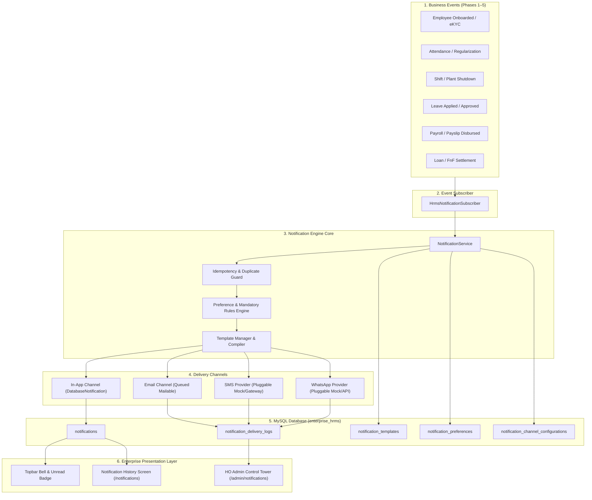

# Phase 6 Architecture Audit: Multi-Channel Notification Engine
**Enterprise HRMS — In-App, Email, SMS & WhatsApp Notification Infrastructure**  
**Date:** November 2, 2026  
**Auditor / Engineering Lead:** Senior Laravel Architect, Security Engineer & HRMS Domain Lead  
**Database Target:** MySQL 8.0.46 (Local Dev) / MySQL 8.4 LTS (Target Production)  
**Framework Version:** Laravel 13 (`13.39.0`) | **PHP:** 8.3.16  

---

## 1. Executive Summary

Phase 6 implements a comprehensive, enterprise-grade **Multi-Channel Notification Engine** supporting:
1. **In-App Notifications** (interactive topbar bell, real-time unread badges, dropdown feed, full history screen with pagination and filters).
2. **Email Notifications** (queued asynchronous delivery, responsive HTML templates, company branding, SMTP preview).
3. **SMS Notifications** (pluggable gateway provider architecture with a compliant Mock provider, status logs, and retry handling).
4. **WhatsApp Notifications** (pluggable Business API provider interface, HSM template parameter substitution, delivery telemetry).
5. **Notification Templates & Placeholders** (multi-company customizable templates with dynamic variables like `{employee_name}`, `{company_name}`, `{action_url}`, `{details}`).
6. **Notification Preferences & Granular Controls** (per-user/per-employee channel toggles per category, while enforcing strict non-suppressible compliance/security alerts).
7. **Queued Asynchronous Delivery & Failure Recovery** (idempotent event dispatching, MySQL queue integration, retry policies, backoff handling, and dead-letter failure logging).
8. **Role-Based Notification Administration** (HO Admin global monitoring, HR Executive company-level auditing, Manager team alerts, and Employee ESS self-service isolation).

---

## 2. Review of Existing Architecture & Reusable Components

### 2.1 Authentication, Users & Employees
- **`User` Model (`App\Models\User`)**:
  - Already implements Laravel's `Illuminate\Notifications\Notifiable` trait.
  - Contains `role_id`, `company_id`, `employee_code`, `email`, `phone`, and `can_switch_company`.
  - Provides convenience helpers: `isHoAdmin()`, `isHr()`, `isHrExecutive()`, `isManager()`, `isEmployee()`.
  - Resolves linked employee record via `$user->employee()` using company-scoped code/email matching.
- **`Employee` Model (`App\Models\Employee`)**:
  - Implements `BelongsToCompany` and `Auditable`.
  - Maintains official employee contact coordinates: `email`, `phone`, `emergency_contact_phone`.
  - Tracks hierarchy via `reporting_manager_id` (`reportingManager` relationship) for tiered managerial escalations.
  - Linked to core operational masters: `location_id`, `department_id`, `category_id`, `designation_id`.

### 2.2 Multi-Company Isolation & Tenancy
- **`CompanyContextService`**:
  - Resolves active company context (`active_company_id`) from session or user assignment.
  - Prevents cross-company spoofing by validating against `can_switch_company` and assigned company ID.
- **`BelongsToCompany` Trait**:
  - Automatically scopes queries with `where('company_id', $activeCompanyId)` unless explicitly bypassed via `withoutGlobalScopes()`.
  - Ensures notifications, preferences, channel configurations, and templates remain strictly tenant-isolated between Vishal Enterprise (`VE`) and Vrishal Eng. Pvt. Ltd. (`VRE`).

### 2.3 Queues & Asynchronous Processing
- **Database Driver (`jobs`, `job_batches`, `failed_jobs`)**:
  - Migrated in Batch 1 (`0001_01_01_000002_create_jobs_table.php`).
  - Active queue connection in `.env` is `database`, using MySQL `jobs` table with InnoDB locking.
  - In `phpunit.xml`, `QUEUE_CONNECTION=sync` ensures synchronous execution in test suites for deterministic assertions.

### 2.4 Mail Infrastructure
- **Laravel Mail Configuration**:
  - Configured with `MAIL_MAILER=log` in `.env` for safe local development.
  - Configured with `MAIL_MAILER=array` in `phpunit.xml` to prevent external transmission during automated tests.
  - Ready for queued Mailable classes (`ShouldQueue`) using Markdown / Blade HTML views.

### 2.5 Security & Audit Logging
- **`AuditLogService` & `audit_logs` Table**:
  - Raw MySQL database triggers enforce append-only immutability on `audit_logs`.
  - Administrative changes to notification templates, channel credentials, or manual retry actions will be audited through `AuditLogService`.

### 2.6 UI / UX Design System
- **`resources/views/layouts/app.blade.php`**:
  - Implements custom Enterprise Design System: Slate primary (`#1E293B`, `#0F172A`), Teal accent (`#0D9488`, `#0F766E`), Warm-neutral canvas (`#F8F9FA`), and semantic status pills.
  - Topbar contains company switcher pill, user profile metadata, and logout button.
  - Provides the exact insertion point for the interactive Notification Bell and dropdown menu.

---

## 3. Identification of Gaps & Required Additions

| Area | Current Project State | Required Phase 6 Implementation |
|---|---|---|
| **Notification Schema** | No `notifications` table migrated yet | Additive migration creating an extended `notifications` table supporting Laravel `Notifiable` while adding `company_id`, `employee_id`, `category`, `event_type`, `channel`, `delivery_status`, `retry_count`, and `failure_reason`. |
| **Notification Templates** | None | Additive migration & model for `notification_templates` with multi-channel support (In-App, Email, SMS, WhatsApp) and mustache/curly placeholders. |
| **Notification Preferences** | None | Additive migration & model for `notification_preferences` per user/employee and category, enforcing non-suppressible mandatory notifications. |
| **Delivery Logs & Telemetry** | None | Additive migration & model for `notification_delivery_logs` capturing channel attempts, gateway responses, latencies, and failure details. |
| **Channel Configuration** | Static `.env` mail only | Additive migration & model for `notification_channel_configurations` supporting per-company gateway settings and mock flags. |
| **Service Layer** | Business services operate without event notifications | `NotificationService` acting as single orchestrator for recipient resolution, preference filtering, template compilation, queued dispatching, and idempotency. |
| **SMS & WhatsApp Gateways** | None | Pluggable interface architecture: `SmsNotificationProviderInterface`, `WhatsAppNotificationProviderInterface`, with robust `MockSmsProvider` and `MockWhatsAppProvider`. |
| **Domain Events** | Services perform DB writes directly without firing Laravel Events | Introduce lightweight Laravel Domain Events and an event subscriber (`HrmsNotificationSubscriber`) connecting business milestones to notifications. |
| **In-App Notification UI** | None | Topbar bell icon, unread counter badge, dropdown notification list, mark as read AJAX/form endpoint, and dedicated history page (`/notifications`). |
| **Notification Administration** | None | HO Admin / HR Executive management portal (`/admin/notifications`) with analytics, template editor, channel configuration, and retry actions. |

---

## 4. Reusability vs. Duplicate Prevention Matrix

To maintain clean architecture and prevent code bloat:
1. **Reuse Laravel's Native Notification Engine**:
   - Do NOT build an ad-hoc custom notification dispatcher when Laravel's `Notification::send()`, `DatabaseNotification`, and `ShouldQueue` provide enterprise-tested queuing, retry handling, and polymorphism.
   - Extend the schema of the `notifications` table so it satisfies both Laravel's built-in `Notifiable` contract (`id`, `type`, `notifiable_type`, `notifiable_id`, `data`, `read_at`) and our HRMS enterprise requirements (`company_id`, `employee_id`, `category`, `event_type`, `channel`, `delivery_status`, `retry_count`).
2. **Reuse Existing Business Services**:
   - Do NOT rewrite or modify the calculation engines of `PayrollCalculationService`, `AttendanceCalculationService`, `LeaveApplicationService`, or `FullAndFinalSettlementService`.
   - Dispatch domain events only after transactional commits succeed, guaranteeing that notification dispatching cannot cause rollbacks of valid business operations.
3. **Reuse Existing RBAC and Tenancy**:
   - Enforce multi-company isolation via `CompanyContextService` and `BelongsToCompany`.
   - Utilize existing middleware `'role:ho_admin,hr_executive'` to gate administrative notification capabilities.

---

## 5. Architectural Blueprint for Phase 6 Stages

---

## 6. Audit Conclusion & Next Steps

The existing Enterprise HRMS codebase provides a rock-solid foundation:
- Multi-company scoping and RBAC are rigorously enforced.
- Database is confirmed as MySQL (with zero SQLite dependencies).
- Queue and Mail configurations are ready for asynchronous processing.
- All Phase 1–5 regression tests pass 100% (132 tests, 809 assertions).

We are clear to advance to **Stage 6B — Notification Database Architecture** to create the additive MySQL migrations.

