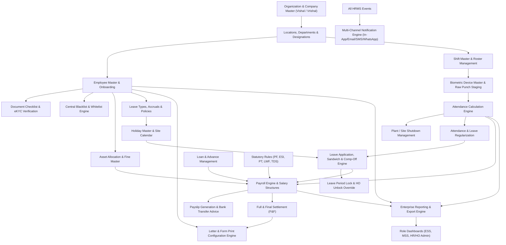

# ENTERPRISE HRMS — SYSTEM ARCHITECTURE & DATABASE DESIGN

## 1. System Architecture Overview

The system follows a modular, domain-driven Laravel 13 architecture adhering to SOLID principles, separation of concerns, and enterprise security standards.

```
+-----------------------------------------------------------------------------------+
|                                PRESENTATION TIER                                  |
|   Bootstrap 5 Custom Design System | Blade Components | Vanilla JS Modules        |
|   Role Views: Employee ESS | Manager / Supervisor MSS | HR & HO Admin Hub         |
+-----------------------------------------------------------------------------------+
                                       |
                                       v
+-----------------------------------------------------------------------------------+
|                                CONTROLLER TIER                                    |
|   Thin HTTP Controllers | FormRequest Validation | Laravel Policies Authorization |
+-----------------------------------------------------------------------------------+
                                       |
                                       v
+-----------------------------------------------------------------------------------+
|                                 SERVICE LAYER                                     |
|   - EmployeeOnboardingService    - BiometricSyncService    - AttendanceEngine     |
|   - LeaveCalculationService      - SandwichRuleService     - PayrollEngine        |
|   - StatutoryTaxService          - LoanAndAdvanceService   - FullAndFinalService  |
|   - NotificationDispatchService  - LetterGenerationService - ExportReportingService|
+-----------------------------------------------------------------------------------+
                                       |
                                       v
+-----------------------------------------------------------------------------------+
|                        DATABASE & INFRASTRUCTURE TIER                             |
|   MySQL 8.4 LTS / 8.0 Relational Engine | Foreign Keys | Transactions | SoftDeletes|
|   Laravel Queue Workers (Notifications, Report Exports, Biometric Ingestion)       |
+-----------------------------------------------------------------------------------+
```

---

## 2. Module Dependency Graph



---

## 3. Relational Database Schema Design

### 3.1 Organization & Master Tables

#### `companies`
- `id` (BIGINT, PK, Auto-Increment)
- `name` (VARCHAR(191)) — e.g. "Vishal Enterprise", "Vrishal Eng. Pvt. Ltd."
- `code` (VARCHAR(50), Unique) — e.g. `VE`, `VRE`
- `cin_number` (VARCHAR(50), Nullable)
- `gstin` (VARCHAR(20), Nullable)
- `pan_number` (VARCHAR(20), Nullable)
- `address` (TEXT)
- `logo_path` (VARCHAR(255), Nullable)
- `letterhead_header` (MEDIUMTEXT, Nullable)
- `letterhead_footer` (MEDIUMTEXT, Nullable)
- `status` (ENUM('Active', 'Inactive'), Default 'Active')
- `created_at`, `updated_at`, `deleted_at`

#### `locations`
- `id` (BIGINT, PK, Auto-Increment)
- `company_id` (BIGINT, FK -> companies.id)
- `name` (VARCHAR(191)) — Plant/Branch name
- `code` (VARCHAR(50), Unique)
- `state` (VARCHAR(100)) — For Professional Tax determination
- `address` (TEXT)
- `is_site` (BOOLEAN, Default FALSE) — Identifies ground staff work sites
- `status` (ENUM('Active', 'Inactive'), Default 'Active')
- `created_at`, `updated_at`, `deleted_at`

#### `departments`
- `id` (BIGINT, PK, Auto-Increment)
- `company_id` (BIGINT, FK -> companies.id)
- `name` (VARCHAR(191))
- `code` (VARCHAR(50))
- `created_at`, `updated_at`, `deleted_at`

#### `designations`
- `id` (BIGINT, PK, Auto-Increment)
- `department_id` (BIGINT, FK -> departments.id)
- `title` (VARCHAR(191))
- `code` (VARCHAR(50))
- `created_at`, `updated_at`, `deleted_at`

#### `categories`
- `id` (BIGINT, PK, Auto-Increment)
- `name` (VARCHAR(100)) — "Staff", "Worker", "Ground Staff", "Executive"
- `code` (VARCHAR(50))
- `notice_period_days` (INT, Default 30)
- `created_at`, `updated_at`

#### `contractors`
- `id` (BIGINT, PK, Auto-Increment)
- `company_id` (BIGINT, FK -> companies.id)
- `agency_name` (VARCHAR(191))
- `contact_person` (VARCHAR(191))
- `phone` (VARCHAR(20))
- `email` (VARCHAR(191))
- `pan` (VARCHAR(20))
- `gstin` (VARCHAR(20))
- `status` (ENUM('Active', 'Inactive'), Default 'Active')
- `created_at`, `updated_at`

---

### 3.2 Employee Master, Identity & Verification

#### `employees`
- `id` (BIGINT, PK, Auto-Increment)
- `company_id` (BIGINT, FK -> companies.id)
- `employee_code` (VARCHAR(50), Unique) — Company-wise unique employee ID
- `gate_pass_number` (VARCHAR(100), Nullable, Index) — Dedicated non-mandatory field
- `employment_channel` (ENUM('Direct', 'Contractor'), Default 'Direct')
- `contractor_id` (BIGINT, FK -> contractors.id, Nullable)
- `employee_type` (ENUM('Permanent', 'Temporary', 'Contract', 'Trainee', 'Other'))
- `location_id` (BIGINT, FK -> locations.id)
- `department_id` (BIGINT, FK -> departments.id)
- `category_id` (BIGINT, FK -> categories.id)
- `designation_id` (BIGINT, FK -> designations.id)
- `reporting_manager_id` (BIGINT, FK -> employees.id, Nullable)
- `first_name` (VARCHAR(100))
- `last_name` (VARCHAR(100))
- `email` (VARCHAR(191), Unique)
- `phone` (VARCHAR(20), Index)
- `gender` (ENUM('Male', 'Female', 'Other'))
- `date_of_birth` (DATE)
- `date_of_joining` (DATE)
- `probation_end_date` (DATE, Nullable)
- `confirmation_date` (DATE, Nullable)
- `aadhaar_hash` (VARCHAR(64), Index) — Tokenized SHA-256 for duplicate matching
- `aadhaar_masked` (VARCHAR(20)) — `XXXX-XXXX-1234`
- `pan_number` (VARCHAR(20), Index)
- `status` (ENUM('Draft', 'Pending Verification', 'Active', 'Inactive', 'Resigned', 'Terminated', 'Transferred'), Default 'Draft')
- `ekyc_status` (ENUM('Not Initiated', 'Pending', 'Resubmission Required', 'Verified', 'Exceptionally Verified', 'Rejected'), Default 'Not Initiated')
- `ekyc_resubmission_deadline` (DATE, Nullable)
- `is_salary_activated` (BOOLEAN, Default FALSE)
- `created_by` (BIGINT, FK -> users.id)
- `created_at`, `updated_at`, `deleted_at`

#### `employee_gate_pass_histories`
- `id` (BIGINT, PK, Auto-Increment)
- `employee_id` (BIGINT, FK -> employees.id)
- `previous_gate_pass` (VARCHAR(100), Nullable)
- `new_gate_pass` (VARCHAR(100))
- `changed_by` (BIGINT, FK -> users.id)
- `reason` (TEXT, Nullable)
- `created_at`

#### `employee_documents`
- `id` (BIGINT, PK, Auto-Increment)
- `employee_id` (BIGINT, FK -> employees.id)
- `document_type` (VARCHAR(100)) — Aadhaar, PAN, Bank Proof, Appointment Letter, Education, Photo, etc.
- `file_path` (VARCHAR(255))
- `original_name` (VARCHAR(255))
- `mime_type` (VARCHAR(100))
- `file_size_kb` (INT)
- `verification_status` (ENUM('Pending', 'Verified', 'Rejected'), Default 'Pending')
- `rejection_reason` (TEXT, Nullable)
- `verified_by` (BIGINT, FK -> users.id, Nullable)
- `verified_at` (TIMESTAMP, Nullable)
- `version` (INT, Default 1)
- `created_at`, `updated_at`

#### `ekyc_verification_logs`
- `id` (BIGINT, PK, Auto-Increment)
- `employee_id` (BIGINT, FK -> employees.id)
- `attempt_number` (INT, Default 1)
- `verification_type` (ENUM('Automated eKYC', 'Manual HO Verification', 'Exception Approval'))
- `status` (ENUM('Success', 'Failed', 'Exception Approved', 'Rejected'))
- `failure_reason` (TEXT, Nullable)
- `resubmission_due_date` (DATE, Nullable)
- `authorized_by` (BIGINT, FK -> users.id, Nullable)
- `metadata` (JSON, Nullable)
- `created_at`

#### `blacklists`
- `id` (BIGINT, PK, Auto-Increment)
- `name` (VARCHAR(191))
- `pan_number` (VARCHAR(20), Index)
- `aadhaar_hash` (VARCHAR(64), Index)
- `phone` (VARCHAR(20), Index)
- `previous_employee_code` (VARCHAR(50), Nullable)
- `previous_company_id` (BIGINT, FK -> companies.id, Nullable)
- `reason_category` (ENUM('Serious Misconduct', 'Financial / Asset Misconduct', 'Absconding', 'Policy Termination', 'Other'))
- `evidence_notes` (TEXT)
- `approval_status` (ENUM('Pending Approval', 'Approved', 'Rejected'), Default 'Pending Approval')
- `approved_by` (BIGINT, FK -> users.id, Nullable)
- `is_active` (BOOLEAN, Default TRUE)
- `whitelisted_at` (TIMESTAMP, Nullable)
- `whitelisted_by` (BIGINT, FK -> users.id, Nullable)
- `whitelist_justification` (TEXT, Nullable)
- `created_at`, `updated_at`

---

### 3.3 Asset Management & Fine Master

#### `assets`
- `id` (BIGINT, PK, Auto-Increment)
- `company_id` (BIGINT, FK -> companies.id)
- `category` (ENUM('IT Equipment', 'Mobile Device', 'Tool / Machinery', 'ID Card', 'Uniform', 'Safety Gear', 'Keys / Access Card', 'Other'))
- `name` (VARCHAR(191))
- `asset_tag` (VARCHAR(100), Unique)
- `serial_number` (VARCHAR(100), Nullable)
- `purchase_date` (DATE, Nullable)
- `purchase_cost` (DECIMAL(12, 2))
- `current_status` (ENUM('In Stock', 'Allocated', 'Damaged', 'Lost', 'Scrapped'), Default 'In Stock')
- `created_at`, `updated_at`

#### `asset_allocations`
- `id` (BIGINT, PK, Auto-Increment)
- `asset_id` (BIGINT, FK -> assets.id)
- `employee_id` (BIGINT, FK -> employees.id)
- `allocated_date` (DATE)
- `condition_at_issue` (TEXT)
- `acknowledged_by_employee` (BOOLEAN, Default FALSE)
- `acknowledged_at` (TIMESTAMP, Nullable)
- `return_date` (DATE, Nullable)
- `condition_at_return` (TEXT, Nullable)
- `clearance_status` (ENUM('Pending', 'Cleared', 'Damaged / Lost Recovery'), Default 'Pending')
- `created_at`, `updated_at`

#### `asset_fine_masters`
- `id` (BIGINT, PK, Auto-Increment)
- `company_id` (BIGINT, FK -> companies.id)
- `violation_item` (VARCHAR(191)) — e.g. "Lost ID Card", "Damaged Hand Tool", "Late Asset Return"
- `default_fine_amount` (DECIMAL(10, 2))
- `is_deductible_from_payroll` (BOOLEAN, Default TRUE)
- `status` (ENUM('Active', 'Inactive'), Default 'Active')
- `created_at`, `updated_at`

#### `asset_damage_penalties`
- `id` (BIGINT, PK, Auto-Increment)
- `asset_allocation_id` (BIGINT, FK -> asset_allocations.id)
- `fine_master_id` (BIGINT, FK -> asset_fine_masters.id, Nullable)
- `assessed_damage_amount` (DECIMAL(10, 2))
- `waived_amount` (DECIMAL(10, 2), Default 0.00)
- `net_payable_amount` (DECIMAL(10, 2))
- `recovery_channel` (ENUM('Payroll Deduction', 'Direct Settlement', 'F&F Settlement'))
- `installment_count` (INT, Default 1)
- `recovered_amount` (DECIMAL(10, 2), Default 0.00)
- `approval_status` (ENUM('Pending', 'Approved', 'Waived'), Default 'Pending')
- `created_at`, `updated_at`

---

### 3.4 Attendance, Shifts, Biometrics & Plant Shutdown

#### `shifts`
- `id` (BIGINT, PK, Auto-Increment)
- `company_id` (BIGINT, FK -> companies.id)
- `name` (VARCHAR(100)) — "General Shift", "Morning Plant Shift", "Night Shift"
- `code` (VARCHAR(50))
- `start_time` (TIME)
- `end_time` (TIME)
- `grace_period_minutes` (INT, Default 15)
- `half_day_minimum_hours` (DECIMAL(4, 2), Default 4.00)
- `full_day_minimum_hours` (DECIMAL(4, 2), Default 8.00)
- `break_duration_minutes` (INT, Default 45)
- `is_overnight` (BOOLEAN, Default FALSE) — Cross-day shift
- `status` (ENUM('Active', 'Inactive'), Default 'Active')
- `created_at`, `updated_at`

#### `biometric_devices`
- `id` (BIGINT, PK, Auto-Increment)
- `location_id` (BIGINT, FK -> locations.id)
- `device_name` (VARCHAR(100))
- `device_ip` (VARCHAR(50))
- `device_port` (INT, Default 4370)
- `serial_number` (VARCHAR(100), Unique)
- `protocol` (ENUM('ZKTeco Push / ADMS', 'Direct IP Poll', 'REST Webhook', 'CSV Manual'))
- `last_sync_at` (TIMESTAMP, Nullable)
- `status` (ENUM('Online', 'Offline', 'Sync Error'), Default 'Offline')
- `created_at`, `updated_at`

#### `biometric_punch_logs` (Raw Staging)
- `id` (BIGINT, PK, Auto-Increment)
- `biometric_device_id` (BIGINT, FK -> biometric_devices.id)
- `biometric_user_id` (VARCHAR(50), Index)
- `employee_id` (BIGINT, FK -> employees.id, Nullable, Index)
- `punch_time` (DATETIME, Index)
- `punch_state` (ENUM('Check-In', 'Check-Out', 'Break-Out', 'Break-In', 'Unknown'))
- `sync_status` (ENUM('Raw', 'Processed', 'Ignored_Duplicate', 'Error'), Default 'Raw')
- `created_at`

#### `attendance_records` (Daily Aggregated Muster)
- `id` (BIGINT, PK, Auto-Increment)
- `employee_id` (BIGINT, FK -> employees.id, Index)
- `date` (DATE, Index)
- `shift_id` (BIGINT, FK -> shifts.id)
- `first_punch_in` (DATETIME, Nullable)
- `last_punch_out` (DATETIME, Nullable)
- `total_work_minutes` (INT, Default 0)
- `late_arrival_minutes` (INT, Default 0)
- `early_departure_minutes` (INT, Default 0)
- `overtime_minutes` (INT, Default 0)
- `status` (ENUM('Present', 'Absent', 'Half Day', 'On Leave', 'Holiday', 'Weekly Off', 'Plant Shutdown', 'On Duty (OD)'), Default 'Absent')
- `regularization_status` (ENUM('None', 'Pending', 'Approved', 'Rejected'), Default 'None')
- `is_locked` (BOOLEAN, Default FALSE)
- `created_at`, `updated_at`, Unique(`employee_id`, `date`)

#### `shutdowns`
- `id` (BIGINT, PK, Auto-Increment)
- `company_id` (BIGINT, FK -> companies.id)
- `title` (VARCHAR(191))
- `shutdown_type` (ENUM('Maintenance', 'Power Outage / Emergency', 'Annual Planned', 'Raw Material Shortage'))
- `from_date` (DATE)
- `to_date` (DATE)
- `scope_type` (ENUM('Company-Wide', 'Location-Wise', 'Department-Wise', 'Category-Wise'))
- `scope_reference_id` (BIGINT, Nullable)
- `employee_compensation_rule` (ENUM('Paid Shutdown', 'Adjust Against Leave', 'Unpaid Shutdown', 'Comp-Off for Duty'))
- `status` (ENUM('Pending Approval', 'Approved', 'Cancelled', 'Completed'), Default 'Pending Approval')
- `reason` (TEXT)
- `created_by` (BIGINT, FK -> users.id)
- `approved_by` (BIGINT, FK -> users.id, Nullable)
- `created_at`, `updated_at`

#### `shutdown_workers` (Staff working during shutdown)
- `id` (BIGINT, PK, Auto-Increment)
- `shutdown_id` (BIGINT, FK -> shutdowns.id)
- `employee_id` (BIGINT, FK -> employees.id)
- `work_date` (DATE)
- `compensation_type` (ENUM('Overtime Pay', 'Comp-Off Credit', 'Special Site Allowance'))
- `supervisor_approved` (BOOLEAN, Default FALSE)
- `created_at`

---

### 3.5 Leave, Sandwich Policies & Holidays (Phase 4 Implemented Schema)

#### `leave_types`
- `id` (BIGINT, PK, Auto-Increment)
- `company_id` (BIGINT, FK -> companies.id)
- `name` (VARCHAR(100)) — "Casual Leave", "Sick / Medical Leave", "Paid / Earned Leave", "Comp-Off", "Maternity Leave", "Paternity Leave", "Loss of Pay"
- `code` (VARCHAR(20)) — Unique within company: `CL`, `SL`, `PL`, `COMP_OFF`, `ML`, `PL_PAT`, `LOP`
- `category` (ENUM('Paid', 'Unpaid', 'Restricted', 'Statutory'), Default 'Paid')
- `annual_quota` (DECIMAL(5, 2), Default 0.00)
- `accrual_frequency` (ENUM('None', 'Monthly', 'Quarterly', 'Bi-Annual', 'Annual'), Default 'Monthly')
- `monthly_accrual_rate` (DECIMAL(5, 2), Default 0.00)
- `accrual_day_of_month` (INT, Default 1)
- `allocation_timing` (ENUM('Beginning of Period', 'End of Period'), Default 'Beginning of Period')
- `allow_carry_forward` (BOOLEAN, Default FALSE)
- `max_carry_forward_days` (DECIMAL(5, 2), Default 0.00)
- `carry_forward_expiry_months` (INT, Nullable)
- `is_encashable` (BOOLEAN, Default FALSE)
- `max_encashable_days` (DECIMAL(5, 2), Default 0.00)
- `min_service_days_required` (INT, Default 0) — Probation / tenure qualification
- `allow_during_probation` (BOOLEAN, Default FALSE)
- `allow_during_notice_period` (BOOLEAN, Default FALSE)
- `is_document_proof_required` (BOOLEAN, Default FALSE)
- `document_proof_threshold_days` (INT, Default 3)
- `is_gender_restricted` (BOOLEAN, Default FALSE)
- `applicable_gender` (ENUM('Male', 'Female', 'All'), Default 'All')
- `status` (ENUM('Active', 'Inactive'), Default 'Active')
- `created_at`, `updated_at`, `deleted_at`

#### `leave_balances`
- `id` (BIGINT, PK, Auto-Increment)
- `company_id` (BIGINT, FK -> companies.id)
- `employee_id` (BIGINT, FK -> employees.id)
- `leave_type_id` (BIGINT, FK -> leave_types.id)
- `year` (INT) — e.g. 2026
- `opening_balance` (DECIMAL(5, 2), Default 0.00)
- `accrued_balance` (DECIMAL(5, 2), Default 0.00)
- `carried_forward` (DECIMAL(5, 2), Default 0.00)
- `consumed_balance` (DECIMAL(5, 2), Default 0.00) — Approved leaves
- `reserved_balance` (DECIMAL(5, 2), Default 0.00) — Pending approval applications
- `encashed_balance` (DECIMAL(5, 2), Default 0.00)
- `expired_balance` (DECIMAL(5, 2), Default 0.00)
- `current_balance` (DECIMAL(5, 2), Virtual/Computed or Managed)
- `created_at`, `updated_at`
- Unique Constraint: `(company_id, employee_id, leave_type_id, year)`

#### `leave_balance_transactions` (Immutable Ledger)
- `id` (BIGINT, PK, Auto-Increment)
- `company_id` (BIGINT, FK -> companies.id)
- `leave_balance_id` (BIGINT, FK -> leave_balances.id)
- `employee_id` (BIGINT, FK -> employees.id)
- `leave_type_id` (BIGINT, FK -> leave_types.id)
- `transaction_type` (ENUM('Opening Balance', 'Monthly Accrual', 'Confirmation Allocation', 'Carry Forward', 'Manual Adjustment', 'Leave Reserved', 'Leave Approved Deduction', 'Leave Rejected Reversal', 'Leave Cancelled Reversal', 'Comp-Off Credit', 'Balance Expiry', 'Encashment'))
- `impact_type` (ENUM('Credit', 'Debit', 'Neutral', 'Reserve', 'Release'))
- `days` (DECIMAL(5, 2))
- `balance_before` (DECIMAL(5, 2))
- `balance_after` (DECIMAL(5, 2))
- `reference_type` (VARCHAR(100), Nullable) — e.g. `LeaveApplication`, `LeaveAccrualBatch`, `CompOffRecord`
- `reference_id` (BIGINT, Nullable)
- `remarks` (TEXT, Nullable)
- `created_by` (BIGINT, FK -> users.id, Nullable)
- `created_at` (TIMESTAMP)

#### `leave_accrual_batches`
- `id` (BIGINT, PK, Auto-Increment)
- `company_id` (BIGINT, FK -> companies.id)
- `year` (INT)
- `month` (INT)
- `leave_type_id` (BIGINT, FK -> leave_types.id, Nullable)
- `total_employees_eligible` (INT, Default 0)
- `total_employees_processed` (INT, Default 0)
- `total_days_accrued` (DECIMAL(8, 2), Default 0.00)
- `status` (ENUM('Pending', 'Processing', 'Completed', 'Failed'), Default 'Completed')
- `executed_by` (BIGINT, FK -> users.id, Nullable)
- `execution_notes` (TEXT, Nullable)
- `created_at`, `updated_at`

#### `leave_carry_forward_batches`
- `id` (BIGINT, PK, Auto-Increment)
- `company_id` (BIGINT, FK -> companies.id)
- `from_year` (INT)
- `to_year` (INT)
- `leave_type_id` (BIGINT, FK -> leave_types.id, Nullable)
- `total_employees_processed` (INT, Default 0)
- `total_days_carried` (DECIMAL(8, 2), Default 0.00)
- `total_days_lapsed` (DECIMAL(8, 2), Default 0.00)
- `is_dry_run` (BOOLEAN, Default FALSE)
- `executed_by` (BIGINT, FK -> users.id, Nullable)
- `created_at`, `updated_at`

#### `holidays`
- `id` (BIGINT, PK, Auto-Increment)
- `company_id` (BIGINT, FK -> companies.id)
- `name` (VARCHAR(191))
- `date` (DATE)
- `holiday_type` (ENUM('Mandatory', 'Restricted', 'Optional', 'Shutdown / Special'), Default 'Mandatory')
- `scope` (ENUM('All Locations', 'Location Specific', 'Ground Staff Only'), Default 'All Locations')
- `location_id` (BIGINT, FK -> locations.id, Nullable)
- `department_id` (BIGINT, FK -> departments.id, Nullable)
- `is_active` (BOOLEAN, Default TRUE)
- `description` (TEXT, Nullable)
- `created_at`, `updated_at`

#### `sandwich_leave_policies`
- `id` (BIGINT, PK, Auto-Increment)
- `company_id` (BIGINT, FK -> companies.id)
- `leave_type_id` (BIGINT, FK -> leave_types.id)
- `applies_to_weekly_off` (BOOLEAN, Default TRUE) — Count intervening weekly off
- `applies_to_holiday` (BOOLEAN, Default TRUE) — Count intervening holiday
- `preceding_leave_counts` (BOOLEAN, Default TRUE) — Treat leave preceding weekly off as sandwich trigger
- `succeeding_leave_counts` (BOOLEAN, Default TRUE) — Treat leave succeeding weekly off as sandwich trigger
- `minimum_sandwich_days` (DECIMAL(4, 2), Default 1.00)
- `description` (TEXT, Nullable)
- `created_at`, `updated_at`

#### `comp_off_records`
- `id` (BIGINT, PK, Auto-Increment)
- `company_id` (BIGINT, FK -> companies.id)
- `employee_id` (BIGINT, FK -> employees.id)
- `attendance_record_id` (BIGINT, FK -> attendance_records.id, Nullable)
- `worked_date` (DATE)
- `worked_minutes` (INT, Default 0)
- `comp_off_days_credited` (DECIMAL(4, 2), Default 1.00)
- `expiry_date` (DATE) — 60 days from worked date
- `status` (ENUM('Pending Verification', 'Approved', 'Availed', 'Expired', 'Rejected'), Default 'Pending Verification')
- `manager_approved_by` (BIGINT, FK -> users.id, Nullable)
- `manager_approved_at` (TIMESTAMP, Nullable)
- `hr_approved_by` (BIGINT, FK -> users.id, Nullable)
- `hr_approved_at` (TIMESTAMP, Nullable)
- `availed_application_id` (BIGINT, Nullable)
- `reason` (TEXT, Nullable)
- `rejection_reason` (TEXT, Nullable)
- `created_at`, `updated_at`

#### `leave_applications`
- `id` (BIGINT, PK, Auto-Increment)
- `company_id` (BIGINT, FK -> companies.id)
- `application_number` (VARCHAR(50), Unique per company)
- `employee_id` (BIGINT, FK -> employees.id)
- `leave_type_id` (BIGINT, FK -> leave_types.id)
- `from_date` (DATE)
- `to_date` (DATE)
- `is_half_day` (BOOLEAN, Default FALSE)
- `half_day_session` (ENUM('First Half', 'Second Half'), Nullable)
- `applied_days` (DECIMAL(4, 2))
- `sandwich_days_added` (DECIMAL(4, 2), Default 0.00)
- `total_deducted_days` (DECIMAL(4, 2))
- `day_breakdown` (JSON, Nullable) — Side-effect free itemized daily status and deduction breakdown
- `reason` (TEXT)
- `emergency_contact_phone` (VARCHAR(20), Nullable)
- `attachment_path` (VARCHAR(255), Nullable)
- `is_notice_period_override` (BOOLEAN, Default FALSE)
- `notice_period_override_reason` (TEXT, Nullable)
- `current_stage` (ENUM('Manager', 'HOD', 'HR', 'Completed', 'Rejected', 'Withdrawn', 'Cancelled'), Default 'Manager')
- `status` (ENUM('Pending', 'Approved', 'Rejected', 'Withdrawn', 'Cancelled'), Default 'Pending')
- `created_at`, `updated_at`, `deleted_at`

#### `leave_approval_steps`
- `id` (BIGINT, PK, Auto-Increment)
- `leave_application_id` (BIGINT, FK -> leave_applications.id)
- `stage` (ENUM('Manager', 'HOD', 'HR'))
- `action` (ENUM('Approved', 'Rejected', 'Withdrawn', 'Cancelled'))
- `action_by` (BIGINT, FK -> users.id)
- `action_at` (TIMESTAMP)
- `remarks` (TEXT, Nullable)
- `created_at`, `updated_at`

#### `leave_period_locks`
- `id` (BIGINT, PK, Auto-Increment)
- `company_id` (BIGINT, FK -> companies.id)
- `year` (INT)
- `month` (INT)
- `is_locked` (BOOLEAN, Default TRUE)
- `locked_by` (BIGINT, FK -> users.id)
- `locked_at` (TIMESTAMP)
- `lock_reason` (VARCHAR(255), Nullable)
- `created_at`, `updated_at`

#### `leave_period_unlock_histories`
- `id` (BIGINT, PK, Auto-Increment)
- `leave_period_lock_id` (BIGINT, FK -> leave_period_locks.id)
- `unlocked_by` (BIGINT, FK -> users.id)
- `unlocked_at` (TIMESTAMP)
- `justification` (TEXT)
- `re_locked_at` (TIMESTAMP, Nullable)
- `re_locked_by` (BIGINT, FK -> users.id, Nullable)
- `created_at`, `updated_at`

#### `employees` (Phase 4 Additions)
- `notice_period_start_date` (DATE, Nullable)
- `notice_period_end_date` (DATE, Nullable)

---

### 3.6 Payroll, Salary, Statutory & Settlement (Production Implemented)

#### `salary_components`
- `id` (BIGINT, PK, Auto-Increment)
- `company_id` (BIGINT, FK -> companies.id)
- `name` (VARCHAR(100))
- `code` (VARCHAR(50), Unique per company)
- `type` (ENUM('Earning', 'Deduction'))
- `is_taxable` (BOOLEAN, Default TRUE)
- `is_statutory` (BOOLEAN, Default FALSE)
- `is_active` (BOOLEAN, Default TRUE)
- `sort_order` (INT, Default 0)
- `created_at`, `updated_at`

#### `salary_structures`
- `id` (BIGINT, PK, Auto-Increment)
- `company_id` (BIGINT, FK -> companies.id)
- `name` (VARCHAR(100))
- `code` (VARCHAR(50), Unique per company)
- `description` (TEXT, Nullable)
- `currency` (VARCHAR(10), Default 'INR')
- `is_target_ot` (BOOLEAN, Default FALSE) — **Target OT structure flag**
- `target_ot_amount` (DECIMAL(10, 2), Default 0.00)
- `is_active` (BOOLEAN, Default TRUE)
- `created_at`, `updated_at`

#### `salary_structure_components`
- `id` (BIGINT, PK, Auto-Increment)
- `salary_structure_id` (BIGINT, FK -> salary_structures.id)
- `salary_component_id` (BIGINT, FK -> salary_components.id)
- `calculation_type` (ENUM('Fixed Amount', 'Percentage of Component', 'Formula'))
- `percentage` (DECIMAL(5, 2), Nullable)
- `percentage_of_component_id` (BIGINT, FK -> salary_components.id, Nullable)
- `formula` (VARCHAR(255), Nullable)
- `default_amount` (DECIMAL(10, 2), Default 0.00)
- `is_mandatory` (BOOLEAN, Default TRUE)
- `sort_order` (INT, Default 0)
- `created_at`, `updated_at`

#### `employee_salary_assignments`
- `id` (BIGINT, PK, Auto-Increment)
- `company_id` (BIGINT, FK -> companies.id)
- `employee_id` (BIGINT, FK -> employees.id)
- `salary_structure_id` (BIGINT, FK -> salary_structures.id)
- `effective_from_date` (DATE)
- `effective_to_date` (DATE, Nullable)
- `ctc_annual` (DECIMAL(12, 2))
- `gross_monthly` (DECIMAL(10, 2))
- `component_values_json` (JSON, Nullable)
- `is_target_ot` (BOOLEAN, Default FALSE)
- `target_ot_amount` (DECIMAL(10, 2), Default 0.00)
- `is_pf_eligible` (BOOLEAN, Default TRUE)
- `is_esi_eligible` (BOOLEAN, Default TRUE)
- `status` (ENUM('Draft', 'Approved', 'Superseded'), Default 'Draft')
- `approved_by` (BIGINT, FK -> users.id, Nullable)
- `approved_at` (TIMESTAMP, Nullable)
- `revision_notes` (TEXT, Nullable)
- `created_at`, `updated_at`

#### `salary_revision_histories`
- `id` (BIGINT, PK, Auto-Increment)
- `company_id` (BIGINT, FK -> companies.id)
- `employee_id` (BIGINT, FK -> employees.id)
- `previous_assignment_id` (BIGINT, FK -> employee_salary_assignments.id, Nullable)
- `new_assignment_id` (BIGINT, FK -> employee_salary_assignments.id)
- `effective_from_date` (DATE)
- `old_ctc_annual` (DECIMAL(12, 2))
- `new_ctc_annual` (DECIMAL(12, 2))
- `increment_percentage` (DECIMAL(5, 2))
- `changed_by` (BIGINT, FK -> users.id)
- `reason` (TEXT, Nullable)
- `created_at`, `updated_at`

#### `payroll_configurations`
- `id` (BIGINT, PK, Auto-Increment)
- `company_id` (BIGINT, FK -> companies.id)
- `pay_cycle_type` (ENUM('Monthly', 'Bi-Weekly', 'Weekly'), Default 'Monthly')
- `cutoff_day` (TINYINT, Default 25)
- `salary_calculation_basis` (ENUM('Calendar Days', 'Fixed 30 Days', 'Standard 26 Days'), Default 'Calendar Days')
- `standard_work_days_per_month` (DECIMAL(4, 2), Default 26.00)
- `ot_hourly_divisor` (DECIMAL(5, 2), Default 208.00)
- `ot_multiplier` (DECIMAL(3, 2), Default 2.00)
- `net_pay_rounding_rule` (ENUM('Round to Nearest Rupee', 'Floor', 'Ceiling'), Default 'Round to Nearest Rupee')
- `is_active` (BOOLEAN, Default TRUE)
- `created_at`, `updated_at`

#### `payroll_statutory_configurations`
- `id` (BIGINT, PK, Auto-Increment)
- `company_id` (BIGINT, FK -> companies.id)
- `pf_employee_rate` (DECIMAL(5, 2), Default 12.00)
- `pf_employer_rate` (DECIMAL(5, 2), Default 12.00)
- `pf_wage_ceiling` (DECIMAL(10, 2), Default 15000.00)
- `pf_restrict_to_ceiling` (BOOLEAN, Default TRUE)
- `pf_eps_rate` (DECIMAL(5, 2), Default 8.33)
- `pf_eps_ceiling` (DECIMAL(10, 2), Default 1250.00)
- `pf_edli_rate` (DECIMAL(5, 2), Default 0.50)
- `pf_admin_rate` (DECIMAL(5, 2), Default 0.50)
- `esi_employee_rate` (DECIMAL(5, 2), Default 0.75)
- `esi_employer_rate` (DECIMAL(5, 2), Default 3.25)
- `esi_wage_ceiling` (DECIMAL(10, 2), Default 21000.00)
- `esi_include_overtime_in_ceiling` (BOOLEAN, Default FALSE)
- `lwf_employee_amount` (DECIMAL(8, 2), Default 12.00)
- `lwf_employer_amount` (DECIMAL(8, 2), Default 36.00)
- `lwf_deduction_frequency` (ENUM('Monthly', 'Bi-Annual June/Dec', 'Annual'), Default 'Bi-Annual June/Dec')
- `standard_deduction_new_regime` (DECIMAL(10, 2), Default 75000.00)
- `standard_deduction_old_regime` (DECIMAL(10, 2), Default 50000.00)
- `section_87a_rebate_limit_new` (DECIMAL(10, 2), Default 700000.00)
- `section_87a_rebate_limit_old` (DECIMAL(10, 2), Default 500000.00)
- `created_at`, `updated_at`

#### `payroll_pt_slabs`
- `id` (BIGINT, PK, Auto-Increment)
- `company_id` (BIGINT, FK -> companies.id)
- `state` (VARCHAR(100))
- `gender` (ENUM('All', 'Male', 'Female'), Default 'All')
- `min_monthly_salary` (DECIMAL(10, 2))
- `max_monthly_salary` (DECIMAL(10, 2), Nullable)
- `tax_amount` (DECIMAL(8, 2))
- `special_month` (TINYINT, Nullable)
- `special_tax_amount` (DECIMAL(8, 2), Nullable)
- `created_at`, `updated_at`

#### `payroll_periods`
- `id` (BIGINT, PK, Auto-Increment)
- `company_id` (BIGINT, FK -> companies.id)
- `year` (SMALLINT)
- `month` (TINYINT)
- `start_date` (DATE)
- `end_date` (DATE)
- `cutoff_date` (DATE)
- `status` (ENUM('Open', 'Processing', 'Locked', 'Closed'), Default 'Open')
- `locked_by` (BIGINT, FK -> users.id, Nullable)
- `locked_at` (TIMESTAMP, Nullable)
- `created_at`, `updated_at`

#### `payroll_runs`
- `id` (BIGINT, PK, Auto-Increment)
- `company_id` (BIGINT, FK -> companies.id)
- `payroll_period_id` (BIGINT, FK -> payroll_periods.id)
- `run_batch_number` (VARCHAR(50), Unique per company)
- `year` (SMALLINT)
- `month` (TINYINT)
- `total_eligible_employees` (INT, Default 0)
- `total_processed_employees` (INT, Default 0)
- `total_gross_earnings` (DECIMAL(14, 2), Default 0.00)
- `total_statutory_deductions` (DECIMAL(14, 2), Default 0.00)
- `total_other_deductions` (DECIMAL(14, 2), Default 0.00)
- `total_deductions` (DECIMAL(14, 2), Default 0.00)
- `total_net_payout` (DECIMAL(14, 2), Default 0.00)
- `total_employer_contributions` (DECIMAL(14, 2), Default 0.00)
- `status` (ENUM('Draft', 'Pre-Validation Passed', 'Pending Approval', 'Approved', 'Locked', 'Rejected', 'Disbursed'), Default 'Draft')
- `processed_by` (BIGINT, FK -> users.id, Nullable)
- `approved_by` (BIGINT, FK -> users.id, Nullable)
- `approved_at` (TIMESTAMP, Nullable)
- `rejection_remarks` (TEXT, Nullable)
- `validation_errors_json` (JSON, Nullable)
- `created_at`, `updated_at`

#### `payroll_approval_steps`
- `id` (BIGINT, PK, Auto-Increment)
- `payroll_run_id` (BIGINT, FK -> payroll_runs.id)
- `stage` (VARCHAR(50))
- `action` (VARCHAR(50))
- `action_by` (BIGINT, FK -> users.id)
- `action_at` (TIMESTAMP)
- `remarks` (TEXT, Nullable)
- `created_at`, `updated_at`

#### `payroll_run_employees`
- `id` (BIGINT, PK, Auto-Increment)
- `company_id` (BIGINT, FK -> companies.id)
- `payroll_run_id` (BIGINT, FK -> payroll_runs.id)
- `employee_id` (BIGINT, FK -> employees.id)
- `employee_salary_assignment_id` (BIGINT, FK -> employee_salary_assignments.id)
- `year` (SMALLINT), `month` (TINYINT)
- `calendar_days` (DECIMAL(4, 2)), `worked_days` (DECIMAL(4, 2)), `paid_leave_days` (DECIMAL(4, 2)), `loss_of_pay_days` (DECIMAL(4, 2)), `paid_days` (DECIMAL(4, 2))
- `overtime_hours` (DECIMAL(6, 2)), `overtime_amount` (DECIMAL(10, 2))
- `basic_salary`, `hra`, `da`, `allowances_amount`, `gross_earnings` (DECIMAL(10, 2))
- `pf_employee`, `esi_employee`, `professional_tax`, `labour_welfare_fund`, `income_tax_tds` (DECIMAL(10, 2))
- `pf_employer`, `esi_employer` (DECIMAL(10, 2))
- `loan_emi_deduction`, `fine_recovery_deduction`, `other_deductions`, `total_deductions`, `net_salary` (DECIMAL(10, 2))
- `payment_status` (ENUM('Pending', 'Paid', 'Hold'), Default 'Pending')
- `payment_reference` (VARCHAR(100), Nullable)
- `paid_at` (TIMESTAMP, Nullable)
- `payslip_number` (VARCHAR(50), Unique)
- `calculation_snapshot_json` (JSON, Nullable)
- `created_at`, `updated_at`

#### `payroll_component_transactions`
- `id` (BIGINT, PK, Auto-Increment)
- `payroll_run_employee_id` (BIGINT, FK -> payroll_run_employees.id)
- `component_type` (ENUM('Earning', 'Deduction'))
- `component_code` (VARCHAR(50))
- `component_name` (VARCHAR(100))
- `standard_amount` (DECIMAL(10, 2))
- `earned_or_deducted_amount` (DECIMAL(10, 2))
- `created_at`, `updated_at`

#### `employee_tax_declarations`
- `id` (BIGINT, PK, Auto-Increment)
- `company_id` (BIGINT, FK -> companies.id)
- `employee_id` (BIGINT, FK -> employees.id)
- `financial_year` (VARCHAR(10))
- `tax_regime` (ENUM('New Regime', 'Old Regime'), Default 'New Regime')
- `sec_80c_amount`, `sec_80d_amount`, `sec_24_home_loan_interest`, `other_exemptions_amount`, `total_declared_deductions` (DECIMAL(10, 2))
- `status` (ENUM('Draft', 'Submitted', 'Verified'), Default 'Draft')
- `verified_by` (BIGINT, FK -> users.id, Nullable)
- `created_at`, `updated_at`

#### `employee_tax_projections`
- `id` (BIGINT, PK, Auto-Increment)
- `company_id` (BIGINT, FK -> companies.id)
- `employee_id` (BIGINT, FK -> employees.id)
- `financial_year` (VARCHAR(10))
- `projected_annual_gross`, `standard_deduction`, `net_taxable_income`, `projected_annual_tax`, `cess_amount`, `net_annual_tax_liability`, `remaining_months`, `monthly_tds_calculated`
- `created_at`, `updated_at`

#### `employee_loans`
- `id` (BIGINT, PK, Auto-Increment)
- `company_id` (BIGINT, FK -> companies.id)
- `employee_id` (BIGINT, FK -> employees.id)
- `loan_application_number` (VARCHAR(50), Unique per company)
- `loan_type` (ENUM('Personal Loan', 'Salary Advance', 'Emergency Medical Advance', 'Festival Advance'))
- `principal_amount` (DECIMAL(10, 2))
- `interest_rate_percent` (DECIMAL(4, 2), Default 0.00)
- `tenure_months` (SMALLINT, Default 1)
- `monthly_emi` (DECIMAL(10, 2))
- `disbursed_amount` (DECIMAL(10, 2), Default 0.00)
- `disbursed_date` (DATE, Nullable)
- `total_recovered` (DECIMAL(10, 2), Default 0.00)
- `remaining_balance` (DECIMAL(10, 2))
- `reason` (TEXT, Nullable)
- `status` (ENUM('Applied', 'Manager Approved', 'HR Approved', 'Disbursed', 'Active', 'Closed', 'Rejected'), Default 'Applied')
- `approved_by` (BIGINT, FK -> users.id, Nullable)
- `approved_at` (TIMESTAMP, Nullable)
- `rejection_reason` (TEXT, Nullable)
- `created_at`, `updated_at`

#### `employee_loan_emi_schedules`
- `id` (BIGINT, PK, Auto-Increment)
- `company_id` (BIGINT, FK -> companies.id)
- `employee_loan_id` (BIGINT, FK -> employee_loans.id)
- `installment_number` (SMALLINT)
- `due_month` (TINYINT)
- `due_year` (SMALLINT)
- `emi_amount`, `principal_component`, `interest_component` (DECIMAL(10, 2))
- `status` (ENUM('Pending', 'Deducted in Payroll', 'Paid via FNF', 'Waived'), Default 'Pending')
- `payroll_run_id` (BIGINT, Nullable)
- `deducted_at` (TIMESTAMP, Nullable)
- `created_at`, `updated_at`

#### `fnf_settlements`
- `id` (BIGINT, PK, Auto-Increment)
- `company_id` (BIGINT, FK -> companies.id)
- `employee_id` (BIGINT, FK -> employees.id)
- `settlement_number` (VARCHAR(50), Unique per company)
- `resignation_date` (DATE)
- `last_working_date` (DATE)
- `notice_period_required_days` (INT)
- `notice_period_served_days` (INT)
- `notice_shortfall_days` (INT)
- `unpaid_salary_days` (DECIMAL(4, 2))
- `unpaid_salary_amount` (DECIMAL(10, 2))
- `leave_encashment_days` (DECIMAL(4, 2))
- `leave_encashment_amount` (DECIMAL(10, 2))
- `gratuity_amount` (DECIMAL(10, 2))
- `notice_shortfall_deduction` (DECIMAL(10, 2))
- `loan_outstanding_deduction` (DECIMAL(10, 2))
- `asset_damage_fine_deduction` (DECIMAL(10, 2))
- `other_deductions_amount` (DECIMAL(10, 2))
- `gross_settlement_amount` (DECIMAL(12, 2))
- `total_deductions_amount` (DECIMAL(12, 2))
- `net_settlement_amount` (DECIMAL(12, 2))
- `settlement_type` (ENUM('Payable to Employee', 'Recoverable from Employee'))
- `status` (ENUM('Draft', 'HR Verified', 'Finance Approved', 'Settled'), Default 'Draft')
- `verified_by` (BIGINT, FK -> users.id, Nullable)
- `approved_by` (BIGINT, FK -> users.id, Nullable)
- `settled_at` (TIMESTAMP, Nullable)
- `remarks` (TEXT, Nullable)
- `created_at`, `updated_at`

#### `fnf_settlement_components`
- `id` (BIGINT, PK, Auto-Increment)
- `fnf_settlement_id` (BIGINT, FK -> fnf_settlements.id)
- `component_category` (ENUM('Earning', 'Deduction'))
- `component_name` (VARCHAR(100))
- `amount` (DECIMAL(10, 2))
- `created_at`, `updated_at`

---

### 3.7 Multi-Channel Notification Engine [PHASE 6 VERIFIED]

#### `notification_channel_configurations`
- `id` (BIGINT UNSIGNED, PK, Auto-Increment)
- `company_id` (BIGINT UNSIGNED, FK -> companies.id, Nullable)
- `channel` (ENUM('in_app', 'email', 'sms', 'whatsapp'))
- `is_enabled` (BOOLEAN, Default TRUE)
- `is_mock` (BOOLEAN, Default TRUE)
- `provider_name` (VARCHAR(50), Default 'mock')
- `credentials` (TEXT, Nullable — Encrypted API secrets)
- `settings` (JSON, Nullable — Rate limits, DLT IDs, WABA numbers)
- `created_by` (BIGINT UNSIGNED, FK -> users.id, Nullable)
- `created_at`, `updated_at`

#### `notification_templates`
- `id` (BIGINT UNSIGNED, PK, Auto-Increment)
- `company_id` (BIGINT UNSIGNED, FK -> companies.id, Nullable)
- `code` (VARCHAR(80)) — e.g. `ONBOARDING_WELCOME`, `LEAVE_APPROVED`, `PAYSLIP_AVAILABLE`
- `name` (VARCHAR(150))
- `category` (ENUM('Onboarding', 'Attendance', 'Shift', 'Leave', 'Payroll', 'Loans', 'Settlement', 'Compliance', 'Security'))
- `event_type` (VARCHAR(100))
- `channel` (ENUM('in_app', 'email', 'sms', 'whatsapp'))
- `subject` (VARCHAR(255), Nullable)
- `body_template` (TEXT) — Supports `{employee_name}`, `{company_name}`, `{action_url}`, etc.
- `action_url` (VARCHAR(255), Nullable)
- `is_mandatory` (BOOLEAN, Default FALSE) — If TRUE, ignores user opt-out
- `is_active` (BOOLEAN, Default TRUE)
- `created_by` (BIGINT UNSIGNED, FK -> users.id, Nullable)
- `created_at`, `updated_at`

#### `notification_preferences`
- `id` (BIGINT UNSIGNED, PK, Auto-Increment)
- `company_id` (BIGINT UNSIGNED, FK -> companies.id)
- `user_id` (BIGINT UNSIGNED, FK -> users.id)
- `employee_id` (BIGINT UNSIGNED, FK -> employees.id, Nullable)
- `category` (ENUM('Onboarding', 'Attendance', 'Shift', 'Leave', 'Payroll', 'Loans', 'Settlement', 'Compliance', 'Security'))
- `channel` (ENUM('in_app', 'email', 'sms', 'whatsapp'))
- `is_enabled` (BOOLEAN, Default TRUE)
- `created_at`, `updated_at`

#### `notifications` (Extended Laravel DatabaseNotification Table)
- `id` (CHAR(36) UUID, PK)
- `type` (VARCHAR(255)) — Notification class name
- `notifiable_type` (VARCHAR(255)), `notifiable_id` (BIGINT UNSIGNED) — Polymorphic recipient
- `company_id` (BIGINT UNSIGNED, FK -> companies.id, Nullable)
- `employee_id` (BIGINT UNSIGNED, FK -> employees.id, Nullable)
- `category` (ENUM('Onboarding', 'Attendance', 'Shift', 'Leave', 'Payroll', 'Loans', 'Settlement', 'Compliance', 'Security'))
- `event_type` (VARCHAR(100), Nullable)
- `channel` (ENUM('in_app', 'email', 'sms', 'whatsapp'), Default 'in_app')
- `template_id` (BIGINT UNSIGNED, FK -> notification_templates.id, Nullable)
- `data` (TEXT JSON) — `{title, body, action_url, category, icon, metadata}`
- `delivery_status` (ENUM('pending', 'dispatched', 'delivered', 'failed', 'skipped'), Default 'delivered')
- `read_at` (TIMESTAMP, Nullable)
- `scheduled_at`, `sent_at` (TIMESTAMP, Nullable)
- `retry_count` (INT UNSIGNED, Default 0)
- `failure_reason` (TEXT, Nullable)
- `idempotency_key` (VARCHAR(120), Unique, Nullable)
- `created_at`, `updated_at`

#### `notification_delivery_logs`
- `id` (BIGINT UNSIGNED, PK, Auto-Increment)
- `company_id` (BIGINT UNSIGNED, FK -> companies.id, Nullable)
- `notification_id` (CHAR(36) UUID, FK -> notifications.id, Nullable)
- `user_id` (BIGINT UNSIGNED, FK -> users.id, Nullable)
- `employee_id` (BIGINT UNSIGNED, FK -> employees.id, Nullable)
- `channel` (ENUM('in_app', 'email', 'sms', 'whatsapp'))
- `recipient_address` (VARCHAR(180)) — Masked phone or email
- `status` (ENUM('queued', 'dispatched', 'delivered', 'failed', 'skipped'))
- `provider_name` (VARCHAR(50), Default 'mock')
- `provider_message_id` (VARCHAR(120), Nullable)
- `payload` (JSON, Nullable)
- `provider_response` (TEXT, Nullable)
- `failure_reason` (TEXT, Nullable)
- `attempt_number` (INT UNSIGNED, Default 1)
- `dispatched_at`, `delivered_at` (TIMESTAMP, Nullable)
- `created_at`, `updated_at`

---

### 3.8 Phase 7: Letter & Form Print Engine, Document Templates & Verification

#### `document_templates`
- `id` (BIGINT UNSIGNED, PK, Auto-Increment)
- `company_id` (BIGINT UNSIGNED, FK -> companies.id, Nullable - Null for Global)
- `category` (VARCHAR(100), Index - Employee Lifecycle, Employee Request, HR Compliance, Employee Forms, Leave & Attendance Forms, Payroll & Finance Forms, Administrative Forms)
- `document_type` (VARCHAR(100), Index)
- `code` (VARCHAR(50), Unique)
- `name` (VARCHAR(255))
- `description` (TEXT, Nullable)
- `content_html` (LONGTEXT)
- `version` (INT UNSIGNED, Default 1)
- `status` (ENUM('Draft', 'Pending Approval', 'Approved', 'Active', 'Inactive', 'Archived'), Default 'Active', Index)
- `effective_from` (DATE, Nullable)
- `effective_to` (DATE, Nullable)
- `requires_approval` (BOOLEAN, Default FALSE)
- `is_sensitive_salary` (BOOLEAN, Default FALSE)
- `header_footer_enabled` (BOOLEAN, Default TRUE)
- `created_by` (BIGINT UNSIGNED, FK -> users.id, Nullable)
- `approved_by` (BIGINT UNSIGNED, FK -> users.id, Nullable)
- `approved_at` (DATETIME, Nullable)
- `created_at`, `updated_at`, `deleted_at`

#### `document_template_versions`
- `id` (BIGINT UNSIGNED, PK, Auto-Increment)
- `document_template_id` (BIGINT UNSIGNED, FK -> document_templates.id, Cascade)
- `version_number` (INT UNSIGNED)
- `content_html` (LONGTEXT)
- `change_summary` (VARCHAR(500), Nullable)
- `created_by` (BIGINT UNSIGNED, FK -> users.id, Nullable)
- `approved_by` (BIGINT UNSIGNED, FK -> users.id, Nullable)
- `created_at`, `updated_at`
- Unique Key: (`document_template_id`, `version_number`)

#### `generated_documents`
- `id` (BIGINT UNSIGNED, PK, Auto-Increment)
- `company_id` (BIGINT UNSIGNED, FK -> companies.id, Cascade)
- `employee_id` (BIGINT UNSIGNED, FK -> employees.id, Cascade)
- `template_id` (BIGINT UNSIGNED, FK -> document_templates.id, Set Null)
- `template_version_id` (BIGINT UNSIGNED, FK -> document_template_versions.id, Set Null)
- `document_number` (VARCHAR(100), Unique, e.g. DOC-VE-2026-00001)
- `verification_code` (VARCHAR(64), Unique, Index, e.g. VE-DOC-8F9B2C1A)
- `category` (VARCHAR(100), Index)
- `document_type` (VARCHAR(100), Index)
- `title` (VARCHAR(255))
- `content_snapshot_html` (LONGTEXT)
- `metadata_snapshot_json` (JSON, Nullable)
- `pdf_file_path` (VARCHAR(500), Nullable)
- `file_size_kb` (INT UNSIGNED, Nullable)
- `status` (ENUM('Draft', 'Pending Approval', 'Approved', 'Generated', 'Issued', 'Rejected', 'Cancelled', 'Archived'), Default 'Generated', Index)
- `effective_date` (DATE, Nullable)
- `requested_by` (BIGINT UNSIGNED, FK -> users.id, Nullable)
- `generated_by` (BIGINT UNSIGNED, FK -> users.id, Nullable)
- `approved_by` (BIGINT UNSIGNED, FK -> users.id, Nullable)
- `approved_at` (DATETIME, Nullable)
- `issued_at` (DATETIME, Nullable)
- `rejection_reason` (TEXT, Nullable)
- `created_at`, `updated_at`, `deleted_at`

#### `document_verification_logs`
- `id` (BIGINT UNSIGNED, PK, Auto-Increment)
- `generated_document_id` (BIGINT UNSIGNED, FK -> generated_documents.id, Set Null)
- `verification_code_queried` (VARCHAR(64), Index)
- `ip_address` (VARCHAR(45), Index)
- `user_agent` (TEXT, Nullable)
- `result_status` (ENUM('Valid', 'Invalid', 'Expired', 'Revoked'), Index)
- `created_at` (TIMESTAMP, Default Current)

---

### 3.12 Enterprise Reporting & Analytics Engine (Batch 12)

#### `report_export_histories`
- `id` (BIGINT UNSIGNED, PK, Auto-Increment)
- `company_id` (BIGINT UNSIGNED, FK -> companies.id, Cascade)
- `user_id` (BIGINT UNSIGNED, FK -> users.id, Cascade)
- `report_type` (VARCHAR(100), Index)
- `format` (ENUM('csv', 'excel', 'pdf'), Index)
- `row_count` (INT UNSIGNED, Default 0)
- `filter_params` (JSON, Nullable)
- `ip_address` (VARCHAR(45), Nullable)
- `user_agent` (TEXT, Nullable)
- `exported_at` (DATETIME, Index)
- `created_at`, `updated_at`
- Composite Index: (`company_id`, `report_type`, `exported_at`)

#### `scheduled_reports`
- `id` (BIGINT UNSIGNED, PK, Auto-Increment)
- `company_id` (BIGINT UNSIGNED, FK -> companies.id, Cascade)
- `created_by` (BIGINT UNSIGNED, FK -> users.id, Cascade)
- `report_type` (VARCHAR(100), Index)
- `format` (ENUM('csv', 'excel', 'pdf'), Default 'csv')
- `frequency` (ENUM('daily', 'weekly', 'monthly'), Default 'weekly')
- `scheduled_time` (VARCHAR(10), Default '08:00')
- `filter_params` (JSON, Nullable)
- `recipients` (JSON)
- `is_active` (BOOLEAN, Default TRUE, Index)
- `last_run_at` (DATETIME, Nullable)
- `next_run_at` (DATETIME, Nullable, Index)
- `created_at`, `updated_at`, `deleted_at`
- Composite Index: (`company_id`, `is_active`, `next_run_at`)

#### `scheduled_report_logs`
- `id` (BIGINT UNSIGNED, PK, Auto-Increment)
- `scheduled_report_id` (BIGINT UNSIGNED, FK -> scheduled_reports.id, Cascade)
- `executed_at` (DATETIME, Index)
- `status` (ENUM('success', 'failed'), Index)
- `recipient_count` (INT UNSIGNED, Default 0)
- `file_path` (VARCHAR(500), Nullable)
- `row_count` (INT UNSIGNED, Default 0)
- `error_message` (TEXT, Nullable)
- `created_at`, `updated_at`
